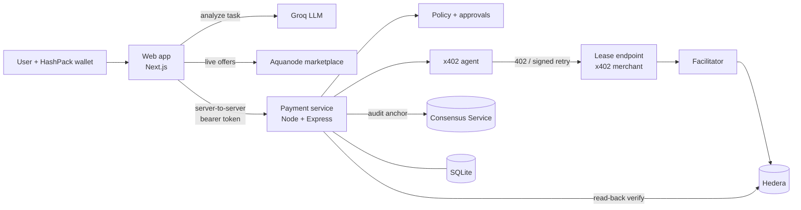

# GPU4U

**Describe a GPU task in plain language. An AI agent finds the cheapest GPU that fits, prices it, and pays for the lease with [x402](https://www.x402.org/) on Hedera, within spending limits you control.**

Built for ETHGlobal. GPU4U joins two things that usually live apart: a live GPU marketplace router and an autonomous-payment engine with guardrails. The agent pays by itself under your limits, asks you first above them, verifies every payment against the ledger, and writes a tamper-evident audit trail.

> **Status: Stage 0.** GPU offers are real and live. The x402 payment protocol is real. Renting the GPU itself is simulated, and real Hedera testnet settlement has not yet been verified end to end (see [What is real and what is not](#what-is-real-and-what-is-not)).

---

## Table of contents

- [The problem](#the-problem)
- [How it works](#how-it-works)
- [Architecture](#architecture)
- [Key features](#key-features)<!--  -->
- [Tech stack](#tech-stack)
- [Repository layout](#repository-layout)
- [Quick start](#quick-start)
- [Configuration](#configuration)
- [Real payments on Hedera testnet](#real-payments-on-hedera-testnet)
- [Spending policy](#spending-policy)
- [Safety properties](#safety-properties)
- [Tests](#tests)
- [What is real and what is not](#what-is-real-and-what-is-not)
- [Documentation](#documentation)

---

## The problem

Renting GPUs means comparing hundreds of offers across many providers, guessing how long a job takes, and paying up front. Letting an AI agent do it for you raises a harder question: **how do you let an agent spend money without handing it a blank cheque?**

GPU4U answers both. A router turns a plain-language task into a ranked list of live offers. A payment engine lets an agent pay over x402, but only inside a policy that is enforced on the server, checked against the ledger, and logged immutably.

## How it works

```text
describe task -> connect wallet -> best GPU + price -> quote (USD -> HBAR)
    -> spending policy -> [your approval] -> agent pays (x402) -> verified on the ledger
    -> lease -> audit trail
```

1. **Describe the task.** An LLM (Groq) turns free text into a validated, structured workload: task type, difficulty, VRAM, budget, GPU count.
2. **Route.** Live offers from the public Aquanode marketplace are filtered by constraints and memory fit, then ranked by estimated total cost.
3. **Quote.** The server prices the chosen GPU and converts USD to HBAR at the Hedera network rate, rounding up to a whole tinybar. The amount is fixed by the quote; the browser cannot change it.
4. **Policy.** The amount is checked against spending limits and resolves to `auto`, `approval` or `refuse`.
5. **Approve** (only above the auto limit). A person approves or rejects. In `wallet` mode, approval needs a wallet signature over the exact terms.
6. **Pay.** The agent calls the lease endpoint, receives **HTTP 402 Payment Required**, checks the terms against the approved quote, signs a transfer, and a facilitator submits it to Hedera.
7. **Verify.** The service does not trust the facilitator. It reads the transaction back from the ledger and confirms the merchant received exactly the quoted amount.
8. **Lease and audit.** Only after verification is a lease created. Every step is written to a hash-chained audit log, anchored on the Hedera Consensus Service in testnet mode.

## Architecture



The browser only talks to the web app. The web app's **server** calls the payment service with a secret token. No key ever reaches the browser, and there is no server-held payer key: in testnet mode the user's own wallet signs every payment.

## Key features

- **Live GPU routing.** Real offers from Aquanode (about 500 usable offers across 10 providers), de-duplicated, normalized, cached and shown with full rejection reasons.
- **Natural-language workloads.** Strict-schema LLM output with provenance rules, plus defaults for anything the user did not state.
- **Real x402.** HTTP 402, client signing and facilitator verify/settle using the official `@x402/*` packages on `hedera:testnet`.
- **Bounded autonomy.** Per-payment, per-wallet daily, hard-ceiling and service-wide limits, all in USD so they do not drift with the HBAR price.
- **Human approval.** Persistent, single-use, expiring approvals, optionally proven by a wallet signature (ED25519 and ECDSA).
- **Independent verification.** Payment is confirmed only when the ledger shows the exact amount, exact payer, no other recipient and a trusted fee payer.
- **Tamper-evident audit.** Hash-chained events in SQLite, anchored to a Hedera Consensus Service topic with a submit key. Secrets are stripped before storage.
- **Simulated mode.** The full flow runs with zero credentials against a simulated ledger, and every receipt says so.

## Tech stack

| Layer | Technology |
| --- | --- |
| Web app | Next.js 16 (App Router), React 19, TypeScript, Tailwind CSS 4, Zod |
| Wallet | HashPack via WalletConnect (`@hashgraph/hedera-wallet-connect`) |
| Task analysis | Groq (`openai/gpt-oss-20b` by default) |
| Marketplace | Aquanode public marketplace API |
| Payment service | Node.js, Express 5, SQLite |
| Payments | x402 v2 (`@x402/core`, `express`, `fetch`, `hedera`), `exact` scheme, native HBAR |
| Ledger | Hedera testnet, `@hiero-ledger/sdk`, mirror node, Hedera Consensus Service |

## Repository layout

```text
Gpu4u/
├── frontend/             Next.js web app
│   ├── app/              Pages and API routes (analyze, marketplace, quotes, payments, approvals, wallet)
│   ├── components/       UI: workload analyzer, GPU ranking, wallet, payment flow
│   ├── lib/              Routing, cost ranking, duration estimation, validation, payment types
│   ├── server/           Server-only: Groq client, Aquanode provider, payment service client
│   └── tests/            128 tests, no network
├── payment-engine/       x402 payment service on Hedera
│   ├── service/          HTTP service: quotes, policy, approvals, agent, facilitator, verifier, audit, HCS
│   ├── payment/          Original terminal engine (kept for `npm run cli`)
│   ├── scripts/          `live-check.js`, one real testnet payment
│   └── tests/            179 tests, no network
└── docs/                 Design documents and the manual testnet checklist
```

## Quick start

Requires **Node 24 or newer**. Use two terminals. No Hedera credentials are needed for simulated mode.

**1. Payment service**

```bash
cd payment-engine
cp .env.example .env     # set SERVICE_TOKEN to a long random string (16+ characters)
npm install
npm start                # http://127.0.0.1:4021, simulated mode
```

**2. Web app**

```bash
cd frontend
cp .env.example .env.local
# set GROQ_API_KEY
# set PAYMENT_SERVICE_TOKEN to the same value as SERVICE_TOKEN above
npm install
npm run dev              # http://localhost:3000
```

Open http://localhost:3000, go to **Get Started**, connect a wallet from the navbar, describe a task, choose a GPU with **Rent**, and follow the payment. With the default limits a small job pays by itself and a larger one stops for your approval.

**Wallet options**

- **Real testnet:** HashPack signs every payment. Set `NEXT_PUBLIC_WALLETCONNECT_PROJECT_ID` (free at https://cloud.reown.com).
- **Simulated (development):** paste an account ID. It identifies you but cannot sign.

## Configuration

**`frontend/.env.local`**

| Variable | Purpose |
| --- | --- |
| `GROQ_API_KEY` | Task analysis (required) |
| `GROQ_MODEL` | Model override (default `openai/gpt-oss-20b`) |
| `PAYMENT_SERVICE_URL` | Where the web server reaches the payment service (default `http://127.0.0.1:4021`) |
| `PAYMENT_SERVICE_TOKEN` | Must equal `SERVICE_TOKEN`. Server only, no `NEXT_PUBLIC` prefix |
| `NEXT_PUBLIC_WALLETCONNECT_PROJECT_ID` | Enables HashPack |
| `AQUANODE_MARKETPLACE_URL` | Optional marketplace endpoint override |

**`payment-engine/.env`** (full reference in [payment-engine/.env.example](payment-engine/.env.example))

| Variable | Purpose |
| --- | --- |
| `PAYMENT_MODE` | `simulated` (default) or `testnet` |
| `SERVICE_TOKEN` | Shared secret with the web server (16+ characters) |
| `APPROVAL_MODE` | `click` (default) or `wallet` (signature required, recommended for anything real) |
| `AUTO_APPROVE_LIMIT_USD`, `DAILY_LIMIT_USD`, `HARD_CEILING_USD`, `GLOBAL_DAILY_LIMIT_USD` | Spending policy |
| `HEDERA_RECEIVER_ID` | Merchant account (testnet). Needs no key |
| `FACILITATOR_FEE_PAYER_ID` / `_KEY` | Funded account that pays network fees (testnet) |
| `HEDERA_HCS_TOPIC_ID` | Audit topic. Leave empty to create one with a submit key |

## Real payments on Hedera testnet

1. Create a **receiver** account and a separate **fee-payer** account at https://portal.hedera.com, and fund the fee payer.
2. In `payment-engine/.env` set `PAYMENT_MODE=testnet`, `HEDERA_RECEIVER_ID`, `FACILITATOR_FEE_PAYER_ID` and `FACILITATOR_FEE_PAYER_KEY`.
3. Start the service. A preflight runs at startup and **refuses to start on any problem**; it never falls back to simulated. Mainnet is refused.
4. Run `npm run live:check` for one real payment using a stand-in payer key, then follow [docs/testnet-manual-test.md](docs/testnet-manual-test.md) for the real HashPack test.

Every confirmed payment shows a HashScan and mirror node link. **Payments are final: there are no refunds**, and ending a lease only closes it. The lease time shown is not GPU utilization.

## Spending policy

All limits are in USD and apply to the amount actually paid up front.

| Setting | Default | Effect |
| --- | --- | --- |
| `AUTO_APPROVE_LIMIT_USD` | 0.50 | Up to this, the agent pays by itself |
| `DAILY_LIMIT_USD` | 5 | One wallet's total in 24 hours. Passing it needs a person |
| `HARD_CEILING_USD` | 25 | Never paid. No approval overrides it |
| `GLOBAL_DAILY_LIMIT_USD` | 50 | Everyone's total in 24 hours. Refused beyond it |

Also refused: any recipient other than the merchant account, an expired quote, and a quote that was already used. The service-wide limit exists because nothing here proves who is asking, so a per-wallet limit alone could be bypassed by inventing wallet IDs.

## Safety properties

- The amount is fixed by a server-side quote. The browser sends no price, and extra fields are rejected.
- The agent refuses to sign if the server changes the price, recipient, asset or fee payer.
- A payment is confirmed only after the transaction is read back from the ledger and matches exactly.
- An approval pays once, even if approved twice at the same moment. Starting the same quote twice pays once.
- A payment caught mid-flight by a restart is failed with a note, never retried, so it cannot pay twice.
- Audit events are hash-chained; `GET /v1/audit/:paymentId` recomputes the chain.

## Tests

```bash
cd payment-engine && npm test     # 179 tests, no network, about 7 seconds
cd frontend && npm test           # 128 tests, no network, about 2 seconds
cd frontend && npx tsc --noEmit && npx eslint app components hooks lib server tests
```

The payment suite covers conversion math, policy, quotes, approvals, the audit chain, the verifier, and the whole service end to end over HTTP, including a hostile server rewriting the terms, an underfunded agent, restarts and concurrency.

## What is real and what is not

| Part | Status |
| --- | --- |
| GPU offers, prices, availability | Real, live from Aquanode |
| Task analysis and input validation | Real |
| Job duration and cost | Estimates from an assumed performance model, not benchmarks |
| x402 payment protocol | Real: HTTP 402, client signing, facilitator verify and settle |
| Settlement | Simulated ledger by default. Real Hedera testnet with `PAYMENT_MODE=testnet` |
| GPU rental and "actual" usage | Simulated. No GPU is rented (needs an Aquanode account and private API) |
| Audit log | Hash-chained in the database. Anchored on Hedera Consensus Service in testnet mode |

**Not yet verified in this repository:** real testnet settlement (needs funded credentials), signing with a real HashPack wallet, and the screens in a browser. Everything that could run without them passes.

## Documentation

| Document | Contents |
| --- | --- |
| [docs/marketplace-and-routing.md](docs/marketplace-and-routing.md) | The live marketplace, input validation, and how the best GPU is chosen |
| [docs/x402-agent-workflow.md](docs/x402-agent-workflow.md) | End-to-end payment design and what was built |
| [docs/testnet-wallet-payments.md](docs/testnet-wallet-payments.md) | How the user's wallet signs real testnet payments |
| [docs/testnet-manual-test.md](docs/testnet-manual-test.md) | Checklist for the real HashPack test |
| [payment-engine/README.md](payment-engine/README.md) | The payment service: modes, HTTP API, states, audit |
