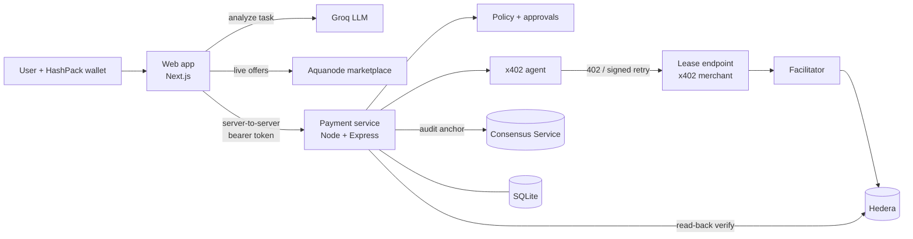

# GPU4U

**Describe a GPU task in plain language. An AI agent finds the cheapest GPU that fits, prices it, and pays for the lease with [x402](https://www.x402.org/) on Hedera, within spending limits you control.**

Built for ETHGlobal. GPU4U joins two things that usually live apart: a live GPU marketplace router and an autonomous-payment engine with guardrails. The agent pays by itself under your limits, asks you first above them, verifies every payment against the ledger, and writes a tamper-evident audit trail.

> **Status.** GPU offers are real and live. x402 payments settle on **Hedera testnet** through our own facilitator, both when a person signs with HashPack and when the autonomous agent pays with its own key, and every payment is re-checked on the public mirror node. The audit log is anchored on a Hedera Consensus Service topic. Renting the GPU itself is still simulated. See [Proof on Hedera testnet](#proof-on-hedera-testnet) and [What is real and what is not](#what-is-real-and-what-is-not).

---

## Table of contents

- [The problem](#the-problem)
- [How it works](#how-it-works)
- [Architecture](#architecture)
- [Key features](#key-features)<!--  -->
- [Tech stack](#tech-stack)
- [Repository layout](#repository-layout)
- [Quick start](#quick-start)
- [Configuration](#configuration)
- [Proof on Hedera testnet](#proof-on-hedera-testnet)
- [The autonomous agent](#the-autonomous-agent)
- [Real payments on Hedera testnet](#real-payments-on-hedera-testnet)
- [Spending policy](#spending-policy)
- [Safety properties](#safety-properties)
- [Tests](#tests)
- [What is real and what is not](#what-is-real-and-what-is-not)
- [Documentation](#documentation)

---

## The problem

Renting GPUs means comparing hundreds of offers across many providers, guessing how long a job takes, and paying up front. Letting an AI agent do it for you raises a harder question: **how do you let an agent spend money without handing it a blank cheque?**

GPU4U answers both. A router turns a plain-language task into a ranked list of live offers. A payment engine lets an agent pay over x402, but only inside a policy that is enforced on the server, checked against the ledger, and logged immutably.

## How it works

```text
describe task -> connect wallet -> best GPU + price -> quote (USD -> HBAR)
    -> spending policy -> [your approval] -> agent pays (x402) -> verified on the ledger
    -> lease -> audit trail
```

1. **Describe the task.** An LLM (Groq) turns free text into a validated, structured workload: task type, difficulty, VRAM, budget, GPU count.
2. **Route.** Live offers from the public Aquanode marketplace are filtered by constraints and memory fit, then ranked by estimated total cost.
3. **Quote.** The server prices the chosen GPU and converts USD to HBAR at the Hedera network rate, rounding up to a whole tinybar. The amount is fixed by the quote; the browser cannot change it.
4. **Policy.** The amount is checked against spending limits and resolves to `auto`, `approval` or `refuse`.
5. **Approve** (only above the auto limit). A person approves or rejects. In `wallet` mode, approval needs a wallet signature over the exact terms.
6. **Pay.** The agent calls the lease endpoint, receives **HTTP 402 Payment Required**, checks the terms against the approved quote, signs a transfer, and a facilitator submits it to Hedera.
7. **Verify.** The service does not trust the facilitator. It reads the transaction back from the ledger and confirms the merchant received exactly the quoted amount.
8. **Lease and audit.** Only after verification is a lease created. Every step is written to a hash-chained audit log, anchored on the Hedera Consensus Service in testnet mode.

## Architecture



The browser only talks to the web app. The web app's **server** calls the payment service with a secret token. No key ever reaches the browser, and there is no server-held payer key: in testnet mode the user's own wallet signs every payment.

## Key features

- **Live GPU routing.** Real offers from Aquanode (about 500 usable offers across 10 providers), de-duplicated, normalized, cached and shown with full rejection reasons.
- **Natural-language workloads.** Strict-schema LLM output with provenance rules, plus defaults for anything the user did not state.
- **Real x402.** HTTP 402, client signing and facilitator verify/settle using the official `@x402/*` packages on `hedera:testnet`.
- **Bounded autonomy.** Per-payment, per-wallet daily, hard-ceiling and service-wide limits, all in USD so they do not drift with the HBAR price.
- **Human approval.** Persistent, single-use, expiring approvals, optionally proven by a wallet signature (ED25519 and ECDSA).
- **Independent verification.** Payment is confirmed only when the ledger shows the exact amount, exact payer, no other recipient and a trusted fee payer.
- **Tamper-evident audit.** Hash-chained events in SQLite, anchored to a Hedera Consensus Service topic with a submit key. Secrets are stripped before storage.
- **Simulated mode.** The full flow runs with zero credentials against a simulated ledger, and every receipt says so.
- **HBAR or USDC.** Pay in native HBAR (priced at the Hedera network rate) or in an HTS token such as USDC (a $1 token, so the quote is exact to the cent with no exchange rate). The ledger check, the agent and the wallet each refuse an asset other than the one quoted.

## Tech stack

| Layer | Technology |
| --- | --- |
| Web app | Next.js 16 (App Router), React 19, TypeScript, Tailwind CSS 4, Zod |
| Wallet | HashPack via WalletConnect (`@hashgraph/hedera-wallet-connect`) |
| Task analysis | Groq (`openai/gpt-oss-20b` by default) |
| Marketplace | Aquanode public marketplace API |
| Payment service | Node.js, Express 5, SQLite |
| Payments | x402 v2 (`@x402/core`, `express`, `fetch`, `hedera`), `exact` scheme, HBAR or HTS USDC |
| Ledger | Hedera testnet, `@hiero-ledger/sdk`, mirror node, Hedera Consensus Service |

## Repository layout

```text
Gpu4u/
├── frontend/             Next.js web app
│   ├── app/              Pages and API routes (analyze, marketplace, quotes, payments, approvals, wallet)
│   ├── components/       UI: workload analyzer, GPU ranking, wallet, payment flow
│   ├── lib/              Routing, cost ranking, duration estimation, validation, payment types
│   ├── server/           Server-only: Groq client, Aquanode provider, payment service client
│   └── tests/            131 tests, no network
├── payment-engine/       x402 payment service on Hedera
│   ├── service/          HTTP service: quotes, policy, approvals, agent, facilitator, verifier, audit, HCS
│   ├── payment/          Original terminal engine (kept for `npm run cli`)
│   ├── scripts/          `live-check.js`, one real testnet payment
│   └── tests/            226 tests, no network
└── docs/                 Design documents and the manual testnet checklist
```

## Quick start

Requires **Node 24 or newer**. Use two terminals. No Hedera credentials are needed for simulated mode.

**1. Payment service**

```bash
cd payment-engine
cp .env.example .env     # set SERVICE_TOKEN to a long random string (16+ characters)
npm install
npm start                # http://127.0.0.1:4021, simulated mode
```

**2. Web app**

```bash
cd frontend
cp .env.example .env.local
# set GROQ_API_KEY
# set PAYMENT_SERVICE_TOKEN to the same value as SERVICE_TOKEN above
npm install
npm run dev              # http://localhost:3000
```

Open http://localhost:3000, go to **Get Started**, connect a wallet from the navbar, describe a task, choose a GPU with **Rent**, and follow the payment. With the default limits a small job pays by itself and a larger one stops for your approval.

**Wallet options**

- **Real testnet:** HashPack signs every payment. Set `NEXT_PUBLIC_WALLETCONNECT_PROJECT_ID` (free at https://cloud.reown.com).
- **Simulated (development):** paste an account ID. It identifies you but cannot sign.


### Run or deploy everything as one unit

The web app and the payment service also run together from the repo root, with one command and one set of variables (see [.env.example](.env.example)):

```bash
npm run install:all
npm run build
SERVICE_TOKEN=$(openssl rand -hex 24) npm start    # web app on $PORT (default 3000)
```

`start.js` starts the payment service on `127.0.0.1:4021` (private), waits for its health check, then starts the web app, which reaches it on localhost. Only the web app is public. If either process stops, both stop so the host restarts them.

**Deploy on Railway (or any Docker host):**

1. Push the repo to GitHub.
2. Create a service from the repo. The `Dockerfile` is picked up automatically.
3. Add the variables from `.env.example`. `NEXT_PUBLIC_WALLETCONNECT_PROJECT_ID` must be set before the build.
4. Generate a public domain and open it.
5. Add that domain to your WalletConnect project's allowed domains.

`DB_PATH=:memory:` keeps payment history in memory only, so it resets on restart. To keep it, attach a volume at `/data` and set `DB_PATH=/data/payments.sqlite`. Run a single instance only.

## Configuration

**`frontend/.env.local`**

| Variable | Purpose |
| --- | --- |
| `GROQ_API_KEY` | Task analysis (required) |
| `GROQ_MODEL` | Model override (default `openai/gpt-oss-20b`) |
| `PAYMENT_SERVICE_URL` | Where the web server reaches the payment service (default `http://127.0.0.1:4021`) |
| `PAYMENT_SERVICE_TOKEN` | Must equal `SERVICE_TOKEN`. Server only, no `NEXT_PUBLIC` prefix |
| `NEXT_PUBLIC_WALLETCONNECT_PROJECT_ID` | Enables HashPack |
| `AQUANODE_MARKETPLACE_URL` | Optional marketplace endpoint override |

**`payment-engine/.env`** (full reference in [payment-engine/.env.example](payment-engine/.env.example))

| Variable | Purpose |
| --- | --- |
| `PAYMENT_MODE` | `simulated` (default) or `testnet` |
| `PAYMENT_ASSET` | `hbar` (default) or `usdc`. See [Paying in USDC](#paying-in-usdc) |
| `USDC_TOKEN_ID` | Token for `usdc` (default: Circle testnet USDC `0.0.429274`) |
| `SERVICE_TOKEN` | Shared secret with the web server (16+ characters) |
| `APPROVAL_MODE` | `click` (default) or `wallet` (signature required, recommended for anything real) |
| `AUTO_APPROVE_LIMIT_USD`, `DAILY_LIMIT_USD`, `HARD_CEILING_USD`, `GLOBAL_DAILY_LIMIT_USD` | Spending policy |
| `HEDERA_RECEIVER_ID` | Merchant account (testnet). Needs no key |
| `FACILITATOR_FEE_PAYER_ID` / `_KEY` | Funded account that pays network fees (testnet) |
| `HEDERA_HCS_TOPIC_ID` | Audit topic. Leave empty to create one with a submit key |

## Proof on Hedera testnet

These are real transactions. Open each on HashScan, or read it from the public mirror node.

| What | Transaction | Paid by | To |
| --- | --- | --- | --- |
| Autonomous agent, no human approving | [`0.0.11326195@1794003677.671713189`](https://hashscan.io/testnet/transaction/0.0.11326195@1794003677.671713189) | agent `0.0.11346382` | merchant `0.0.11326170` |
| Autonomous agent, second run | [`0.0.11326195@1794003771.569117993`](https://hashscan.io/testnet/transaction/0.0.11326195@1794003771.569117993) | agent `0.0.11346382` | merchant `0.0.11326170` |
| A person signing with HashPack | [`0.0.11326195@1794001717.864746004`](https://hashscan.io/testnet/transaction/0.0.11326195@1794001717.864746004) | wallet `0.0.11329382` | merchant `0.0.11326170` |

In each one the facilitator account `0.0.11326195` paid the network fee, so the payer needed no HBAR for gas. The audit log for the agent's payment is on HCS topic [`0.0.11342109`](https://hashscan.io/testnet/topic/0.0.11342109), which only this service can write to: all 10 events of the first agent payment were read back from the mirror node and matched.

## The autonomous agent

[payment-engine/agent/gpu-agent.js](payment-engine/agent/gpu-agent.js) is an agent that finds the x402 endpoint, compares the live marketplace and pays for a GPU lease on its own, with no human approving. Its key is held by the agent process. The server never holds a payer key.

```bash
cd payment-engine
npm run agent:create                      # once: creates and funds the agent's own testnet account, saves its key to .env.agent
npm run agent -- "Run inference on a 7B model with 2000 prompts, cheapest option" --max-total 0.30
npm run agent -- "..." --dry-run          # find, compare, quote and read the 402 price, but do not pay
```

What it does, step by step:

1. **Discover.** Reads `/.well-known/x402` from the payment service: the endpoint, network, asset, recipient, facilitator and the spending limits it must obey.
2. **Understand.** Turns the task into requirements (model size, VRAM, GPU count, how to optimize) with the Groq analyzer.
3. **Compare.** Ranks the live Aquanode marketplace (about 450 offers) by estimated total cost and picks the best. When optimizing for cost it checks that the pick really is the cheapest eligible offer.
4. **Quote.** Gets a server-priced quote. The price is recomputed on the server from live data, never taken from the agent.
5. **Spending policy.** Pays by itself only under the automatic limit. A payment above it needs a human, so the agent stops (exit code 2) and pays nothing. A payment over the hard ceiling or to an unknown recipient is refused (exit code 3).
6. **Dynamic 402.** Asks the endpoint for the price with an unpaid request and gets HTTP 402 with the exact amount for this quote. It refuses to sign if that amount or the recipient differs from the quote.
7. **Pay.** Signs the x402 `exact` transfer with its own key. The facilitator co-signs as fee payer and submits it to Hedera.
8. **Verify.** Reads the transaction back from the public mirror node and checks the result, the merchant's credit, the agent's debit and who paid the fee, without trusting the service.
9. **Lease and audit.** Holds then ends the lease, and checks that the hash-chained audit log is intact.

The endpoint is public to ask about: an unpaid `POST /v1/leases` with a `quoteId` returns 402 and moves no money. A payment, though, is accepted only through the service's relay, which checks that the signed transfer is exactly the one quoted.

## Hackathon track checklist: AI Agents That Pay, x402 on Hedera

| Requirement | Status | Where |
| --- | --- | --- |
| x402-protected endpoint settling on Hedera testnet, through a facilitator we run | Done, real testnet | `POST /v1/leases`, local facilitator using the official `@x402/hedera` `exact` scheme |
| An agent that finds the endpoint and completes a paid request with no human approving | Done, real testnet | [The autonomous agent](#the-autonomous-agent), transactions in [Proof](#proof-on-hedera-testnet) |
| Public repo with a README covering setup, architecture, payment flow and a settled transaction ID | Done | This file |
| Demo video of 5 minutes or less showing a payment settling and its HashScan link | Not done: record it with the agent run above and open the transaction on HashScan | |
| Extra: spending controls for agents | Done: per-payment auto limit, per-wallet daily limit, hard ceiling, service-wide limit, recipient allowlist, human approval above the limit | [Spending policy](#spending-policy) |
| Extra: an HCS topic as a tamper-evident audit log of each agent's spending | Done, real testnet: every event is hash-chained and posted to the topic with a submit key, then read back and compared | `payment-engine/service/hcs.js` |
| Extra: settling in an HTS token such as USDC | Built and tested on the simulated ledger only, not yet run on testnet | [Paying in USDC](#paying-in-usdc) |
| Extra: HCS-14 / ERC-8004 identity, A2A/ACP negotiation, scheduled payments, Hedera Agent Kit | Not built | |

## Real payments on Hedera testnet

1. Create a **receiver** account and a separate **fee-payer** account at https://portal.hedera.com, and fund the fee payer.
2. In `payment-engine/.env` set `PAYMENT_MODE=testnet`, `HEDERA_RECEIVER_ID`, `FACILITATOR_FEE_PAYER_ID` and `FACILITATOR_FEE_PAYER_KEY`.
3. Start the service. A preflight runs at startup and **refuses to start on any problem**; it never falls back to simulated. Mainnet is refused.
4. Run `npm run live:check` for one real payment using a stand-in payer key, then follow [docs/testnet-manual-test.md](docs/testnet-manual-test.md) for the real HashPack test.

Every confirmed payment shows a HashScan and mirror node link. **Payments are final: there are no refunds**, and ending a lease only closes it. The lease time shown is not GPU utilization.

## Paying in USDC

By default a payment is in HBAR. Set `PAYMENT_ASSET=usdc` in `payment-engine/.env` to settle in an HTS token instead (Circle's testnet USDC, `0.0.429274`, unless `USDC_TOKEN_ID` says otherwise). Because the token is worth $1, the quote is the USD cap in token units, with no exchange rate and no price drift between quote and payment.

1. **Associate the token** with the receiver: `ASSOCIATE_ACCOUNT_ID=0.0.x ASSOCIATE_ACCOUNT_KEY=... npm run associate` (in `payment-engine`). HashPack associates for the user's account inside the wallet.
2. **Fund the wallet** with test USDC at https://faucet.circle.com (choose Hedera Testnet).
3. Start the service. Startup refuses to run if the token is missing, paused, not fungible, has other than 6 decimals, or the receiver cannot receive it. A quote is refused up front if the wallet is not associated or holds too little.

The user's wallet pays only the token. The facilitator fee payer still pays the network fee, in HBAR. Details: [payment-engine/README.md](payment-engine/README.md#paying-in-hbar-or-usdc).

## Spending policy

All limits are in USD and apply to the amount actually paid up front.

| Setting | Default | Effect |
| --- | --- | --- |
| `AUTO_APPROVE_LIMIT_USD` | 0.50 | Up to this, the agent pays by itself |
| `DAILY_LIMIT_USD` | 5 | One wallet's total in 24 hours. Passing it needs a person |
| `HARD_CEILING_USD` | 25 | Never paid. No approval overrides it |
| `GLOBAL_DAILY_LIMIT_USD` | 50 | Everyone's total in 24 hours. Refused beyond it |

Also refused: any recipient other than the merchant account, an expired quote, and a quote that was already used. The service-wide limit exists because nothing here proves who is asking, so a per-wallet limit alone could be bypassed by inventing wallet IDs.

## Safety properties

- The amount is fixed by a server-side quote. The browser sends no price, and extra fields are rejected.
- The agent refuses to sign if the server changes the price, recipient, asset or fee payer.
- A payment is confirmed only after the transaction is read back from the ledger and matches exactly.
- An approval pays once, even if approved twice at the same moment. Starting the same quote twice pays once.
- A payment caught mid-flight by a restart is failed with a note, never retried, so it cannot pay twice.
- Audit events are hash-chained; `GET /v1/audit/:paymentId` recomputes the chain.

## Tests

```bash
cd payment-engine && npm test     # 226 tests, no network, about 10 seconds
cd frontend && npm test           # 131 tests, no network, about 2 seconds
cd frontend && npx tsc --noEmit && npx eslint app components hooks lib server tests
```

The payment suite covers conversion math, policy, quotes, approvals, the audit chain, the verifier, and the whole service end to end over HTTP, including a hostile server rewriting the terms, an underfunded agent, restarts and concurrency.

## What is real and what is not

| Part | Status |
| --- | --- |
| GPU offers, prices, availability | Real, live from Aquanode |
| Task analysis and input validation | Real |
| Job duration and cost | Estimates from an assumed performance model, not benchmarks |
| x402 payment protocol | Real: HTTP 402, client signing, facilitator verify and settle |
| Settlement | Real Hedera testnet with `PAYMENT_MODE=testnet` (verified, see [Proof](#proof-on-hedera-testnet)). A simulated ledger is the default for development |
| Signing | Real HashPack wallet (verified), and the agent's own key (verified) |
| USDC (HTS token) payments | Built and tested end to end on the simulated ledger. Not yet run on testnet, and HashPack signing a token transfer is unverified |
| Job size in the estimate | The analyzer extracts model size, VRAM and difficulty, but not the number of prompts or tokens in your text, so volumes come from defaults and difficulty |
| GPU rental and "actual" usage | Simulated. No GPU is rented (needs an Aquanode account and private API) |
| Audit log | Hash-chained in the database. Anchored on Hedera Consensus Service in testnet mode |

**Not yet verified:** USDC on testnet, and a demo recording. The screens were exercised through the same API calls and a running dev server, not driven in a browser by an automated test.

## Documentation

| Document | Contents |
| --- | --- |
| [docs/marketplace-and-routing.md](docs/marketplace-and-routing.md) | The live marketplace, input validation, and how the best GPU is chosen |
| [docs/x402-agent-workflow.md](docs/x402-agent-workflow.md) | End-to-end payment design and what was built |
| [docs/testnet-wallet-payments.md](docs/testnet-wallet-payments.md) | How the user's wallet signs real testnet payments |
| [docs/testnet-manual-test.md](docs/testnet-manual-test.md) | Checklist for the real HashPack test |
| [payment-engine/README.md](payment-engine/README.md) | The payment service: modes, HTTP API, states, audit |
