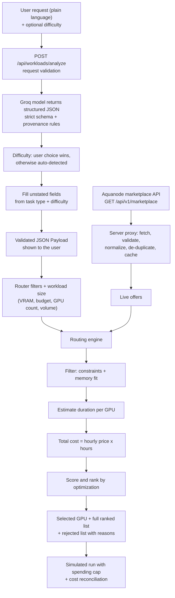

# GPU4U: Real Marketplace, Input Validation and GPU Selection

This document explains how GPU4U turns a plain-language request into one recommended GPU, using live offers from the Aquanode marketplace API. It covers where the data comes from, how every input is validated, how each GPU is judged, and what is still simulated.

Status: Stage 0. Offers are real and live. Durations and costs are model-based estimates. Execution and billing are simulated. No GPU is rented and no payment is made.

## 1. The flow at a glance



## 2. The real marketplace API

GPU4U reads offers from the public Aquanode marketplace feed. Reference: https://docs.aquanode.io/docs/api/marketplace

```
GET https://server.aquanode.io/api/v1/marketplace
```

- **No account or API key.** The endpoint is free and unauthenticated.
- **Not callable from a browser.** It sends no CORS header, so a cross-origin `fetch` from a page is blocked. GPU4U calls it from the server only. The browser calls our own route, `GET /api/marketplace`.
- **Gentle polling.** The feed is slow (one call took about 13 seconds, another about 2.5) and may be rate limited. The server caches each result for 30 seconds, shares one in-flight request between callers, and the page polls every 30 seconds.
- **Failure handling.** If the upstream call fails and an earlier snapshot exists, the server returns that snapshot marked `stale: true`. With no earlier snapshot it returns HTTP 502 and the page shows an error.

Our route returns:

| Field | Meaning |
| --- | --- |
| `offers` | Normalized offers (section 2.2) |
| `servedFrom` | `upstream` (fetched just now), `cache` (a recent fetch within the 30 second TTL) or `stale-cache` (the refresh failed) |
| `upstreamMs` | How long the Aquanode fetch that produced this data took |
| `fetchedAt` | When our server fetched the data |
| `apiTimestamp` | Timestamp reported by Aquanode |
| `stale` | True when serving the last good snapshot after a failed refresh |
| `totalRaw`, `skipped`, `duplicatesRemoved` | Counts that show what normalization dropped |

Optional setting: `AQUANODE_MARKETPLACE_URL` overrides the endpoint.

### Seeing the routing

The path is browser, then our server route, then Aquanode. Both legs are now visible:

- **Browser to our route:** the DevTools Network tab. The response carries the fields above.
- **Our route to Aquanode:** the server logs, one line per upstream call. Cache hits are not logged because no call is made.

  ```
  [aquanode] fetched 200 in 2543ms offers=505 skipped=2 duplicates=125
  [aquanode] stale 503 after 30002ms (serving last good data): Marketplace returned HTTP 503
  [aquanode] error after 120ms (no cached data): fetch failed
  ```
- **On the home page:** a collapsible "Data path" panel shows the three hops, whether the data came from Aquanode or the cache, how long the fetch took, and how many rows were received, de-duplicated, skipped and kept.

### 2.1 What the live feed looks like (observed 2026-11-06)

About 635 raw rows, roughly 125 of them exact duplicates, leaving about 505 usable offers across 10 providers. Numbers drift as capacity changes.

The live feed differs from the documentation page in ways the code accounts for:

- The docs list nine providers. The live feed also returned `nebius`, `aws` and `jarvislabs`.
- Each offer has extra fields the docs do not mention. The important one is `priceBasis`, which states whether `price` covers the whole offer (`node`) or one GPU (`gpu`). We trust it over the docs' "only Akash is per GPU" rule, and use that rule only when `priceBasis` is absent.
- `gpuMemory` appears as `"24"`, `"24GB"`, `"24Gi"`, `"180GB"` and similar.
- Some rows are exact duplicates and are removed.

### 2.2 How a raw offer becomes a GPU4U offer

Code: [aquanode.ts](../frontend/server/marketplace/aquanode.ts), [aquanode-provider.ts](../frontend/server/marketplace/aquanode-provider.ts).

| GPU4U field | Source and rule |
| --- | --- |
| `gpuModel` | `gpuShortName`, prettified (`RTX4090` becomes `RTX 4090`) |
| `gpuKey` | `gpuShortName` upper-cased, letters and digits only. Used to look up performance specs |
| `vramGb` | Parsed from `gpuMemory`. The `Gi` suffix is treated as GB. Unparseable or non-positive values drop the offer |
| `gpuCount` | `gpuCount`, the number of GPUs bundled in the offer |
| `bundlePricePerHourUsd` | The whole offer's hourly price. `price` when `priceBasis` is `node`, else `price x gpuCount` |
| `pricePerHourUsd` | Per GPU-hour. `price / gpuCount` for `node`, `price` for `gpu` |
| `available` | `available > 0` and `availabilityLevel` is not `NONE` |
| `region` | `region`, or `unknown` when empty |
| `cudaSupported` | `gpuVendorFamily` is `nvidia`. When the family is null, inferred from the model name |
| `id` | `provider:address:gpuCount`, with `#2`, `#3` added on a collision |

Normalization is strict about the envelope and forgiving about rows. A response that is not `{ success: true, data: [...] }` is treated as a failure. A single bad row is skipped and counted in `skipped`, so one malformed offer cannot take down the whole marketplace.

### 2.3 What was removed

The mock provider, the mock GPU list and the mock marketplace test are gone. Tests that need offers now use a recorded excerpt of the real response ([the fixture](../frontend/tests/fixtures/aquanode-marketplace.snapshot.json)), run through the same normalizer as production. Nothing in the marketplace path is invented.

## 3. How the input is validated

Validation happens in layers. Each layer rejects or corrects something the previous one cannot.

| Layer | Where | What it guarantees |
| --- | --- | --- |
| 1. Request check | `/api/workloads/analyze` route | Body is JSON with only `request` (10 to 4000 characters, trimmed) and an optional `difficulty` of `easy`, `medium` or `hard`. Anything else is HTTP 400 |
| 2. Structured output | Groq call | The model must return JSON matching a strict schema (`json_schema` with `strict: true`, temperature 0). No extra keys are allowed |
| 3. Schema validation | `workload.schema.ts` (zod) | Types and ranges are exact. VRAM and budget must be positive. GPU count must be a positive integer. Task type, optimization and difficulty must be from fixed lists |
| 4. Provenance rules | `parseWorkloadAnalysis` | Every field says where its value came from: `user_provided`, `estimated`, `default` or `missing`. A field is `missing` exactly when it is `null`. GPU count and optimization are never missing. A default GPU count must be 1. A default optimization must be `balanced`. Difficulty is never missing and is only `user_provided` or `estimated` |
| 5. Difficulty selection | `withDifficultySelection` | If the user picked a difficulty, it overrides the model's and is marked `user_provided`. Otherwise the auto-detected value is kept |
| 6. Gap filling | `fillMissingRequirements` | Any requirement the user did not state is filled and marked `estimated` (section 3.2) |
| 7. Router filters | Get Started page | The user can still edit minimum VRAM, hourly budget and GPU count before ranking |

Failures at layers 2 to 4 return a clear error and never reach the router. The user is not shown an unvalidated payload.

### 3.1 Difficulty

Before analysis the user can choose Easy, Medium or Hard, or leave it on Auto-detect. The Validated JSON Payload always contains a `difficulty` value:

- **Chosen by the user:** shown with source `user_provided`.
- **Left on auto:** the model judges it from model size and workload and the source is `estimated`.

The final difficulty then scales the job volume the user has not set themselves, using assumed multipliers of 0.25 (easy), 1 (medium) and 4 (hard) on prompts, dataset tokens and reference hours. Values the user types are never scaled, and model size is never scaled. This is how difficulty changes the estimated duration, the cost, the ranking and the suggested spending cap.

### 3.2 Filling fields the user did not state

If task type, model, minimum VRAM, hourly budget or CUDA are missing, the server fills them from the task type and difficulty. The filled fields are marked `estimated`, and the clarification questions are replaced by one note naming which fields were estimated. Anything the user stated is never overwritten.

| Field | Rule |
| --- | --- |
| Task type | Defaults to `inference` |
| Model | If the user describes a kind of model without naming one (such as image generation), the analyzer names a representative one, for example `stable-diffusion-xl`. If nothing is said, a representative LLM per task and difficulty. For inference: Llama 3.2 3B (easy), Llama 3 8B (medium), Llama 3 70B (hard). Fine-tuning and training have their own tables |
| Minimum VRAM | Estimated memory for that model and task, divided across the GPU count, rounded up to a standard size (8, 12, 16, 24, 40, 48 or 80 GB). With no known model size it falls back to 8, 16 or 40 GB by difficulty |
| Hourly budget | An assumed rate for that VRAM size, multiplied by the GPU count. A starting point, not a market quote |
| CUDA required | `true` |

Code: [requirement-defaults.ts](../frontend/server/analysis/requirement-defaults.ts).

## 4. How the best GPU is selected

Code: [cost-ranking.ts](../frontend/lib/routing/cost-ranking.ts), [duration-estimator.ts](../frontend/lib/estimation/duration-estimator.ts), [gpu-performance.ts](../frontend/lib/estimation/gpu-performance.ts).

### Step 1: describe the job

A workload profile holds the size of the job: task type, model size in billions of parameters, number of prompts, input and output tokens, batch size, dataset tokens, epochs, LoRA or full fine-tune, and precision. The user can edit each one. Fields still at their default are labelled "default" in the form.

### Step 2: filter the offers

Every offer is checked against every constraint. An offer that fails any check is rejected, and every reason is recorded and shown.

| Constraint | Rule |
| --- | --- |
| Availability | The offer must be rentable now |
| GPU count | The bundle must have exactly the requested number of GPUs |
| Minimum VRAM | Per-GPU VRAM must be at least the minimum |
| CUDA | Must support CUDA when required |
| Hourly budget | The whole-offer hourly price must not exceed it |
| Memory fit | Estimated memory need must fit in total VRAM |
| Total budget | Estimated total cost must not exceed it |
| Duration limit | Estimated duration must not exceed it |

An offer is a fixed bundle at a fixed price, so GPU4U only matches bundles of exactly the requested size and bills the whole bundle. It never assumes a 4-GPU offer can be rented as 2 GPUs at a pro-rata price.

### Step 3: estimate how long the job takes on each GPU

Time depends on the GPU, so the cheapest hourly price is not enough. A cheap slow GPU can cost more overall than an expensive fast one.

Each GPU has two numbers: memory bandwidth and FP16 compute throughput, taken from approximate vendor spec sheets. They are combined with fixed efficiency factors:

| Assumption | Value |
| --- | --- |
| Share of bandwidth achieved while decoding | 65% |
| Share of peak compute in inference | 45% |
| Share of peak compute in training | 35% |
| Each extra GPU adds | 90% of one GPU |
| Startup | 30 s plus weight loading at 2 GB/s |

- **Inference** = startup + prefill + decode. Prefill is `2 x parameters x input tokens` of compute. Decode runs one step per generated token per batch, and each step takes the slower of reading the weights (memory-bound) and doing the batch's math (compute-bound). A larger batch therefore helps until the GPU becomes compute-bound.
- **Training and fine-tuning** = `6 x parameters x tokens x epochs` of compute, or `4 x` for LoRA.
- **Rendering and other** = the user's "hours on one H100" scaled by relative compute.
- **Memory need** = weights plus 20% for inference, 40% for LoRA, about 16 bytes per parameter for full training.

A GPU that is not in the spec table is assumed to run at 10% of an H100 and is tagged "low confidence" in the results.

### Step 4: compute total cost

```
total cost = whole-offer hourly price x estimated duration in hours
```

### Step 5: score and rank

The optimization preference decides what "best" means:

| Preference | Cost weight | Speed weight | Order |
| --- | --- | --- | --- |
| Lowest total cost | 1.0 | 0.0 | Lowest estimated total cost, ties broken by shorter duration |
| Balanced | 0.5 | 0.5 | Highest routing score |
| Fastest | 0.2 | 0.8 | Highest routing score |

```
routing score = 100 x ( cost weight x (lowest cost / this cost)
                      + speed weight x (shortest time / this time) )
```

A score of 100 means "best on every dimension that counts". With cost optimization the selected GPU is always the cheapest estimated total, and the lowest-cost row always scores 100.

### Step 6: show the result

The page shows the top 25 eligible GPUs with model, provider, hourly price, estimated duration, estimated total and score. The selected row is marked. Estimates are labelled as estimates throughout.

## 5. Worked example

Request: "Run Llama 3 8B inference with at least 16 GB VRAM, maximum $2 per hour, find the cheapest GPU."

Job: 5,000 prompts, 512 input and 256 output tokens each, batch size 8, FP16, one GPU. The numbers below come from the recorded fixture (a 204-offer excerpt of the live feed from 2026-11-06), not from the full live feed.

29 offers were eligible and 175 were rejected. The first-listed reasons for the rejected ones: 98 had the wrong bundle size, 28 had too little VRAM, 24 were unavailable, 14 exceeded the hourly budget, 8 would not fit the model in memory.

**Cost optimization**

| GPU | Provider | VRAM | Hourly | Est. duration | Est. total | Score |
| --- | --- | --- | --- | --- | --- | --- |
| RTX 3090 (selected) | simplepod | 24 GB | $0.22 | 1.54 h | $0.34 | 100 |
| A100 | simplepod | 40 GB | $0.46 | 0.80 h | $0.37 | 92 |
| RTX 4090 | simplepod | 24 GB | $0.39 | 1.25 h | $0.48 | 70 |
| RTX 5090 | akash | 32 GB | $0.67 | 0.74 h | $0.50 | 68 |
| RTX 4090 | akash | 24 GB | $0.42 | 1.25 h | $0.52 | 65 |

The winner's 1.54 hours breaks down as 38 seconds of startup, 1,282 seconds of prefill and 4,208 seconds of decode.

**Same job with "Fastest"** selects an 80 GB A100 at about $1.49 per hour. It finishes in 0.63 hours but costs about $0.93, nearly three times the cheapest option. The preference changes the answer, which is the point of having it.

**Why the hourly price alone misleads.** For a 70B model on one GPU in the same data, the lowest hourly rate was an MI300X at $3.29 per hour. The estimate is 30.8 hours, about $101. A B200 at $9.35 per hour is estimated at 1.3 hours, about $12.37. Note that the MI300X is not in the spec table, so its estimate is the low-confidence fallback.

## 6. How we check the choice is the best one

"Best" here means: the lowest estimated total cost (or best score) among the offers that satisfy every constraint, under the performance model above. It is not a claim about real benchmarks. The pick is checked in four ways:

1. **Tests assert the optimality rule.** The selected offer's cost equals the minimum over all eligible offers, the ranked list is sorted by cost, and every ranked offer satisfies VRAM, GPU count, CUDA, budget and duration limits. Tests also cover the case where the cheapest hourly rate is not the cheapest job.
2. **The decision is auditable.** The page lists all ranked offers and every rejected offer with the reason, so a person can see why a GPU lost.
3. **Constraints are hard limits.** A budget or memory limit removes an offer before scoring. It is never traded off against speed.
4. **Estimates are reconciled after a run.** The simulated run compares estimated and billed cost and flags a gap of more than 5%. When real execution exists, this is the feedback that should be used to tune the efficiency factors above.

## 7. Usage-based billing (simulated)

Code: [usage-billing.ts](../frontend/lib/billing/usage-billing.ts).

1. The user approves a maximum spend. It must be a positive number. The panel suggests 25% above the estimate. A cap below the estimate triggers a warning that the job will likely stop early.
2. A usage meter accrues cost per second at the selected offer's whole-offer hourly rate, in whole micro-dollars so there is no rounding drift.
3. The meter never passes the cap. When the next second would exceed it, the run stops and the job is marked stopped at the cap, with the share of the job completed.
4. The "actual" duration is simulated, from 0.8x to 1.3x of the estimate, fixed per job id. It is labelled **simulated** everywhere and is never presented as a measurement.
5. After the run, reconciliation reports estimated cost, billed cost, the difference in dollars and percent, and how much of the approved cap went unused. The outcome is within tolerance (5%), under-estimated, over-estimated or stopped at cap.

## 8. What is real and what is not

| Part | Status |
| --- | --- |
| GPU offers, prices, availability, regions | Real, live from Aquanode |
| Input analysis (Groq) and schema validation | Real |
| GPU performance and job duration | Estimated from an assumed model. Not benchmarks |
| Estimated total cost | Estimated. Prices can change before a rental happens |
| Job execution and the "actual" duration | Simulated |
| Billing, spending cap, reconciliation | Simulated logic. No money moves |
| Deploy dialog commands | Illustrative placeholders. Nothing is provisioned |

Known limits:

- About 11% of live offers use GPU models missing from the spec table and carry the low-confidence tag.
- The performance constants are assumptions. Until real runs are measured, rankings between GPUs of similar value can be wrong.
- The duration model is built for LLM-style jobs. For other model types, such as image generation, the model size is unknown and the estimate uses the default 7B-class profile. Edit the workload size, or choose the rendering or other task type, for a closer figure.
- Availability is as reported by the provider at fetch time and can be gone by the time a rental is attempted.
- `Gi` VRAM values are treated as GB.
- A single marketplace call can be slow, so the first page load can wait several seconds.

## 9. Running and verifying

```bash
cd frontend
cp .env.example .env.local   # set GROQ_API_KEY
npm install
npm run dev                  # http://localhost:3000
npm test                     # unit tests, no network needed
npx tsc --noEmit && npx eslint app components hooks lib server tests
```

The tests need no network. They run against the recorded fixture and a fake fetch, and cover VRAM parsing, price normalization, duplicate removal, caching, cache status, stale fallback, the upstream log events, the API handlers, request validation, duration estimation, cost ranking, budget and constraint enforcement, and billing reconciliation.

## 10. Code layout

The backend lives inside the Next.js app, in a `server/` folder, so there is one app to run and deploy and no CORS to manage. If real GPU provisioning, real payments or live job updates are added later, `server/` is the part to lift into its own service.

```
frontend/
  app/api/**        thin route files: one line each, calling server/api
  server/           code that only runs on the server
    api/            request handlers and request validation
    marketplace/    Aquanode client, normalizer, cache
    ai/             Groq analyzer (holds the API key)
    analysis/       filling fields the user did not state
    logger.ts       one log line per Aquanode call
  lib/              pure code shared by the server and the browser
    estimation/  routing/  billing/  validation/  marketplace/ (types, browse ranking)
  app/, components/, hooks/   browser code
```

Estimation, routing and billing stay in `lib/` rather than `server/` because the browser runs them too: ranking and the simulated run happen on the Get Started page. They are pure functions with no secrets, so sharing them is safe.

A lint rule enforces the boundary. Files in `components/`, `hooks/` and the pages cannot import from `server/`, so an API key or an upstream call cannot end up in the browser bundle by accident.

## 11. File map

| Area | Files |
| --- | --- |
| API routes | `app/api/marketplace/route.ts`, `app/api/workloads/analyze/route.ts` |
| Server | `server/api/*`, `server/marketplace/aquanode.ts`, `aquanode-provider.ts`, `server/ai/groq.ts`, `server/analysis/requirement-defaults.ts`, `server/logger.ts` |
| Shared marketplace types | `lib/marketplace/types.ts`, `ranking.ts` |
| Input validation | `lib/validation/workload.schema.ts`, `server/api/analyze-request.ts` |
| Estimation | `lib/estimation/workload-profile.ts`, `gpu-performance.ts`, `duration-estimator.ts`, `difficulty.ts` |
| Routing | `lib/routing/cost-ranking.ts` |
| Billing | `lib/billing/usage-billing.ts` |
| UI | `app/page.tsx`, `app/get-started/page.tsx`, `components/` (including `DataPathPanel.tsx`), `hooks/useMarketplace.ts` |
| Tests | `tests/*.test.ts`, `tests/fixtures/` |
