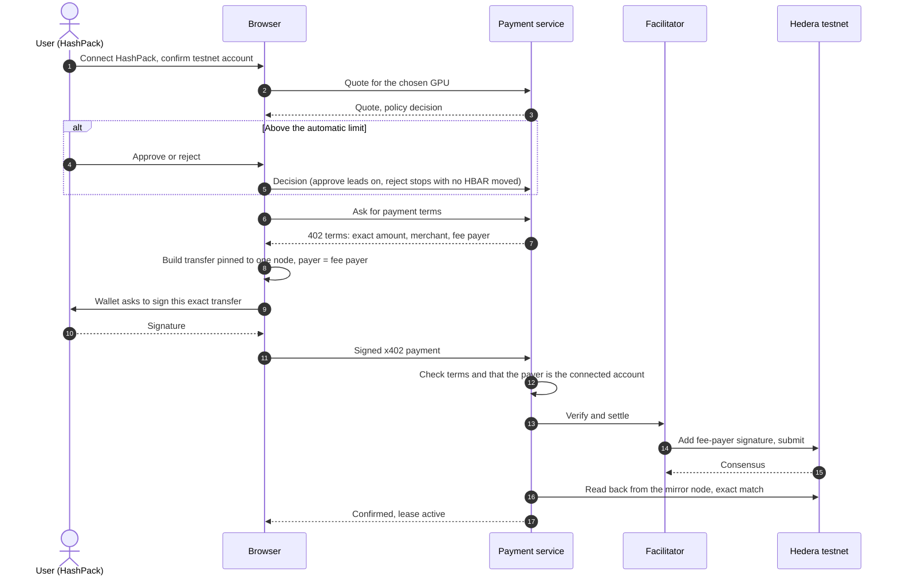

# Real Hedera Testnet Payments with the User's Wallet: Findings and Proposal

This document answers the questions raised before changing any code for the real-testnet milestone, reports what was found, and proposes the implementation. No application code was changed for it.

Status key used below: **Verified** means observed by running code or querying a live service. **Reasoned** means concluded from source code or documentation. **Unverified** means it needs something this environment does not have: a HashPack wallet, a browser, or funded Hedera credentials.

## 1. Answers to the five questions

### 1.1 The exact Hedera x402 payment scheme

| Property | Value | Status |
| --- | --- | --- |
| Protocol version | x402 v2 | Verified |
| Scheme | `exact` | Verified |
| Network | `hedera:testnet` (CAIP-2) | Verified |
| Asset | Native HBAR, entity `0.0.0`, amounts in tinybars | Verified |
| Package | `@x402/hedera` 2.30.0 with `@x402/core` 2.30.0 | Verified |
| Payment object | A partially signed `TransferTransaction` in the payload, base64 | Verified |

The transaction the client must build, taken from the official client signer's source:

- It moves the amount from the payer to the merchant. The payer's account is the transfer sender.
- Its **transaction ID names the facilitator's fee-payer account**, not the payer. The facilitator pays the network fee.
- It is signed **only by the payer's key**. The facilitator adds the fee-payer signature when it submits.

The official facilitator rejects the payload unless the fee payer is a managed facilitator account, the fee payer is never a net sender of value, the transfers sum to zero, the amount credited to the merchant is exact, and the payer's signature is valid against the payer's on-chain key.

### 1.2 The facilitator

Two hosted facilitators advertise `hedera:testnet` with no account or key needed. Both were queried live.

| Facilitator | URL | Fee payer | Status |
| --- | --- | --- | --- |
| Blocky402 | `https://api.testnet.blocky402.com` | `0.0.7162784` | Verified advertising Hedera testnet |
| Official x402 | `https://x402.org/facilitator` | `0.0.9185802` | Verified advertising Hedera testnet |

The current code's testnet default is Blocky402. A local facilitator is also supported (`FACILITATOR_MODE=local`) and runs the official scheme in this repository's process with a funded fee-payer account of your own.

### 1.3 The actual settlement mechanism

The facilitator verifies the payload, adds its fee-payer signature, executes the transaction on the Hedera testnet, and waits for a successful receipt. Our service then reads the transaction back from the mirror node and requires an exact match before it creates a lease. Both steps are real in testnet mode.

**The current implementation does not use your wallet for any of this.** In testnet mode the payer is a server-held "agent" account whose private key sits in the service's environment, and the agent signs every payment itself. That is real settlement, but it is the opposite of what this milestone asks for. It must change.

### 1.4 Can the connected HashPack wallet sign the required payload?

**Probably yes, but not with the library's default behavior, and one wallet-side point is unverified.**

**Verified: a naive wallet signing path produces a payload the facilitator rejects.** A Hedera wallet signs through WalletConnect's `hedera_signTransaction`, which takes one transaction body and returns one signature. The wallet library then copies that signature onto every per-node copy of the transaction. The official x402 client freezes the transfer with the SDK's default nodes, which produced **7 per-node copies**. A signature over the first body is invalid for the other six. I emulated the wallet with an SDK key and ran the result through the official facilitator verification:

| Transaction built | Node copies | Official facilitator verification |
| --- | --- | --- |
| Official client signer (signs every copy) | 7 | Accepted |
| Wallet-style signature, default nodes | 7 | **Rejected: `signature_invalid`** |
| Wallet-style signature, pinned to one node | 1 | **Accepted, and settled on the simulated ledger** |

The one-node variant also carried the longest allowed validity window (180 seconds) and a memo, and still verified. So the browser must pin the transfer to a single node before asking the wallet to sign. This was an emulation with a key, not HashPack itself.

**Reasoned: the approach matches what the ecosystem describes.** A Hedera-maintained x402 guide lists "HashPack via WalletConnect / UniversalProvider" as a buyer wallet and describes a WalletConnect payment-retry flow ([x402-payments skill](https://raw.githubusercontent.com/hedera-dev/hedera-skills/master/plugins/native-services-js/skills/x402-payments/SKILL.md)). The WalletConnect Hedera method takes a signer account and a base64 transaction body and returns a signature map ([Hedera RPC reference](https://docs.walletconnect.com/advanced/multichain/rpc-reference/hedera-rpc)).

**Unverified: whether HashPack agrees to sign a body whose fee payer is a different account.** The payer account is inside the transaction ID the wallet is shown. The WalletConnect specification names the signer separately and does not say whether the two may differ. I found nothing from HashPack that settles it ([HashPack WalletConnect docs](https://docs.hashpack.app/dapp-developers/walletconnect.md)). This can only be answered by trying it. It is the main technical risk of the milestone, and section 4 gives the fallback if HashPack refuses.

Other wallet-side unknowns: whether your HashPack account uses an ECDSA or ED25519 key (the facilitator checks either through the mirror node, but the Hedera guide lists an ECDSA wallet), and how HashPack displays a transaction it will not pay for.

### 1.5 Are refunds genuinely supported?

**Yes, but a refund is not an x402 payment, and it must not be described as one.** x402's `exact` scheme moves money from a client to a server in one direction only. There is no refund primitive. A refund is an ordinary HBAR transfer from the merchant account to the user's account, signed with the merchant's key. That is genuinely executable on testnet and verifiable on the ledger, and the receipt should label it a standard transfer.

Conditions checked on the mirror node: the user's account must exist, and it must have `receiver_sig_required` set to false, otherwise the refund would need the user's signature. The mirror node exposes this field (confirmed on a public testnet account). The merchant needs a funded key, and pays the small network fee for the refund.

## 2. Where the current code conflicts with this milestone

| Requirement | Current behavior | Conflict |
| --- | --- | --- |
| Payer is the user's wallet | The server-held agent key signs and pays | **Architectural.** The x402 client has to move to the browser |
| Wallet authorizes the exact payment | The wallet is only an identity and can sign an approval message | The payment is never shown to the wallet |
| Manual account ID as a wallet | Accepted, and cannot sign | Must not be usable for payments in testnet mode |
| Verification expects the agent as payer | `payer` is the agent account | Must expect the wallet account |
| Refund goes to the agent | Sent to the payment's payer, which is the agent | Must go to the user's wallet |
| Usage is a simulated run | A deterministic simulation | See 3.5: there is no real GPU to measure |
| HCS confirmation | Records the sequence number from the submit receipt | Not independently confirmed on the mirror node |
| Mode separation | `simulated` or `testnet`, but a funded agent key is shared with the live check | Needs stricter guards, see 3.6 |

Things that already satisfy the milestone and stay as they are: the quote and policy engine, the approval store, the audit hash chain, the Hedera Consensus Service publisher with a submit key, the independent mirror verification, the facilitator scheme, and all 203 automated tests. Simulated mode keeps working unchanged for development and tests.

## 3. Proposed implementation

### 3.1 The architecture change

The payer becomes the user's wallet. Because the user's key lives in HashPack, **the x402 client's signing step moves into the browser**. The server stays the x402 merchant.

### 3.2 Changes by requirement

| # | Requirement | Change |
| --- | --- | --- |
| 1 | Real wallet | Testnet mode requires a WalletConnect session, shows the connected account and key type, checks the balance and `receiver_sig_required`, and disables the manual account entry for payments. The browser builds the one-node transfer and asks the wallet to sign it. No hard-coded sender and no server signature stand in for the user |
| 2 | Real x402 settlement | The service gives the browser the exact 402 terms for the quote, then accepts the signed payment and relays it to its own x402 lease endpoint, which verifies and settles through the facilitator. It rejects a payload whose sender is not the quote's wallet. The mirror node check expects the wallet as payer. No lease exists before verification, as now |
| 3 | Automatic payment | Under the automatic limit there is no approval card, but the wallet still prompts for the payment. The policy skips the human decision, never the wallet signature |
| 4 | Human approval | Above the limit the payment waits in `PENDING_APPROVAL`. Approve leads to the wallet signature and settlement. Reject ends it with no HBAR moved, and nothing was signed. The hard ceiling is enforced before approval is offered and cannot be overridden |
| 5 | Billing and refunds | See 3.5. A real refund transfer from the merchant to the user's wallet, verified on the mirror node, plus a final receipt |
| 6 | HCS audit | Keep the chain and the publisher. Add a step that reads each posted message back from the mirror node, compares its content to the event hash, and only then marks it confirmed, with the consensus timestamp |
| 7 | Configuration | See 3.6 |
| 8 | Browser test | See section 5 |

### 3.3 Approval and the wallet signature

Large payments need two things: the owner's decision, and the wallet's signature over the payment. The signature over the exact transfer is itself cryptographic consent to that amount, so I recommend the approval decision be a recorded click and the wallet prompt follow it, instead of a second signed message that adds a popup and no extra safety. The signed-message mode already exists and can stay available. The result is one wallet prompt for small payments and one wallet prompt after a click for large ones.

### 3.4 What the browser and the server each check

- **Server, before relaying a payment:** the payment is in the right state, the quote has not expired, the signed payload's terms equal the stored quote exactly, and the transfer's sender is the quote's wallet. The facilitator then checks the signature against the account's on-chain key.
- **Browser, before asking the wallet:** the terms it received match what the user was shown, the network is testnet, and the asset is HBAR. The wallet shows the user the transfer itself.
- **Timing:** the transaction is valid for at most 180 seconds from when the browser builds it. It is built only when the user clicks pay, so the time spent in the wallet prompt counts. A slow approval produces an expired transaction, which fails cleanly and can be retried with a fresh quote.

### 3.5 Billing: what "actual usage" can mean

**No real GPU is rented, so there is no real GPU usage to measure.** Renting from Aquanode needs an Aquanode account and its private API, which spends real money and is not Hedera testnet. I will not present a simulation as a measurement.

What can be real is **metered lease time**. The lease starts when payment is confirmed. The user ends it, or it ends by itself when the paid cap is reached, and the bill is the quoted hourly rate times the elapsed seconds, never more than the cap. That is a real, measured quantity: the time the lease was held. It is not GPU utilization, and the receipt will say so. The unused part is returned by a genuine testnet refund, verified on the ledger.

If you would rather keep the deterministic simulation, that stays available, and it is labelled simulated.

### 3.6 Configuration and secrets

- **Two modes, never mixed.** `PAYMENT_MODE=testnet` refuses to start unless it has a funded merchant key, a reachable facilitator that advertises `hedera:testnet`, and an audit operator. It never substitutes the simulated ledger, a fixed account, or a fixed rate. If anything is missing it stops with a clear error.
- **Testnet only.** The network is a constant. A mainnet identifier is rejected, and no mainnet facilitator is configured.
- **Server-only secrets.** Merchant key, facilitator fee-payer key, and the service token stay in the payment service. The browser receives only public information: account IDs, amounts, and signatures it produced itself. Environment files are ignored by Git, and the audit log already strips secret-looking fields.
- **No agent key in the web workflow.** The old agent key is kept only for an operator check script, labelled as such, and is not used by the application in testnet mode.
- **Visible mode.** The page shows whether it is running simulated or on Hedera testnet, and refuses to proceed if the app and service disagree.

### 3.7 Accounts you need for real testnet

| Account | Purpose | Needs |
| --- | --- | --- |
| Your HashPack testnet account | The payer. Signs each payment | Testnet HBAR, `receiver_sig_required` false |
| Merchant account | Receives payments, sends refunds, pays for audit messages | A key in the service, and a little testnet HBAR to start |
| Facilitator fee payer | Pays network fees | Provided by a hosted facilitator, or your own funded account for a local one |

Testnet HBAR comes free from the [Hedera faucet](https://portal.hedera.com/faucet). A Reown (WalletConnect) project ID is also needed, and is free.

## 4. Risks and the fallback

| Risk | Likelihood | If it happens |
| --- | --- | --- |
| HashPack refuses to sign a body whose fee payer is another account | Unknown | Fallback in 4.1 |
| A hosted facilitator rejects a one-node transaction | Low, since the official scheme accepted it | Use a local facilitator running the official scheme, with your own funded fee-payer account |
| The wallet signs slowly and the 180-second window expires | Medium | Fail cleanly, retry with a fresh quote. The window cannot be longer |
| The chosen node is down | Low | Choose among live nodes and retry with another |
| The mirror node is slow | Observed: some calls timed out | Verification already retries. The retry window will be lengthened |
| The user's key is ED25519 | Unknown | The facilitator checks either key type through the mirror node. Test it |

### 4.1 If HashPack will not sign the payload

There is no way to relax the x402 `exact` scheme's fee-payer rule. The correct fallback keeps x402 genuine: the user funds a **session budget** with an ordinary wallet transfer to a server-held agent account, signed in HashPack, and the agent then pays through x402 under the spending policy. The wallet authorizes a real transfer, and the x402 payments are real. But the wallet would not be authorizing each x402 payment, so this does not meet requirement 1 as written, and I would only build it if you choose it. I will not describe a plain wallet transfer as an x402 payment.

## 5. What I can and cannot verify

**I can build and test here:** the browser transaction builder, its single-node requirement against the official facilitator verification with a key standing in for the wallet, the server-side relay and its checks, the mode guards, mirror-based verification of payments, refunds and audit messages with recorded responses, the metered billing, and the receipt.

**I cannot do here, and you would run:** anything needing HashPack or a browser (I have neither, and I would not handle a seed phrase), and anything needing funded credentials. That includes connecting HashPack, signing in the wallet, a genuine settlement, a genuine refund, and a genuine audit message. For those I will deliver a step-by-step manual test with exact expected outcomes, and an operator script that exercises the real settlement, refund and audit path with your funded accounts and prints the HashScan links.

**Manual test checklist (to be run with HashPack):**

1. Connect HashPack and confirm the displayed account equals the one in the wallet, on testnet.
2. Request a GPU and review the quote: amount, rate, expiry.
3. Pay a small amount. Confirm the wallet shows a transfer to the merchant for the exact amount, and no approval card appeared.
4. Confirm on HashScan that the HBAR left your account and reached the merchant, and that the facilitator paid the fee.
5. Confirm the receipt's transaction ID matches and the verification says exact match, and that the lease exists only after that.
6. Request a larger GPU job. Confirm it waits for approval, with nothing signed. Reject it and confirm no HBAR moved. Repeat and approve, then sign in the wallet and confirm settlement.
7. End the lease early. Confirm the bill, the refund transaction on HashScan, and the final receipt.
8. Open the audit trail and confirm each event's topic message on HashScan matches its hash.
9. Try a job above the hard ceiling and confirm it is refused with no wallet prompt.

## 6. Decisions I need from you

1. **Wallet fee-payer risk.** Do you accept that HashPack's behavior is untested, with the section 4.1 fallback if it refuses?
2. **First facilitator.** Do you want a local facilitator with your own funded fee-payer account for the first real run (recommended, because its behavior is the verified official code), or the hosted Blocky402 directly?
3. **Billing.** Is metered lease time, with a real refund, acceptable as "actual usage" given that no GPU is rented?
4. **Approval.** Is a recorded click followed by the wallet signature acceptable (recommended), or do you want a signed approval message as well?

With your answers, or with the recommended defaults if you reply "go ahead", the work is the browser signer, the server relay and its checks, the mode guards, the metered lease and real refund, the mirror confirmation of audit messages, the receipt, the manual checklist, and tests. Simulated mode and the existing tests stay as they are.

## Sources

- [x402 on Hedera: how it works](https://docs.hedera.com/solutions/ai/x402/how-it-works)
- [x402 on Hedera: the exact scheme](https://docs.hedera.com/solutions/ai/x402/exact-scheme)
- [Hedera x402 payments skill, listing HashPack via WalletConnect as a buyer wallet](https://raw.githubusercontent.com/hedera-dev/hedera-skills/master/plugins/native-services-js/skills/x402-payments/SKILL.md)
- [WalletConnect Hedera RPC reference](https://docs.walletconnect.com/advanced/multichain/rpc-reference/hedera-rpc)
- [HashPack WalletConnect developer docs](https://docs.hashpack.app/dapp-developers/walletconnect.md)
