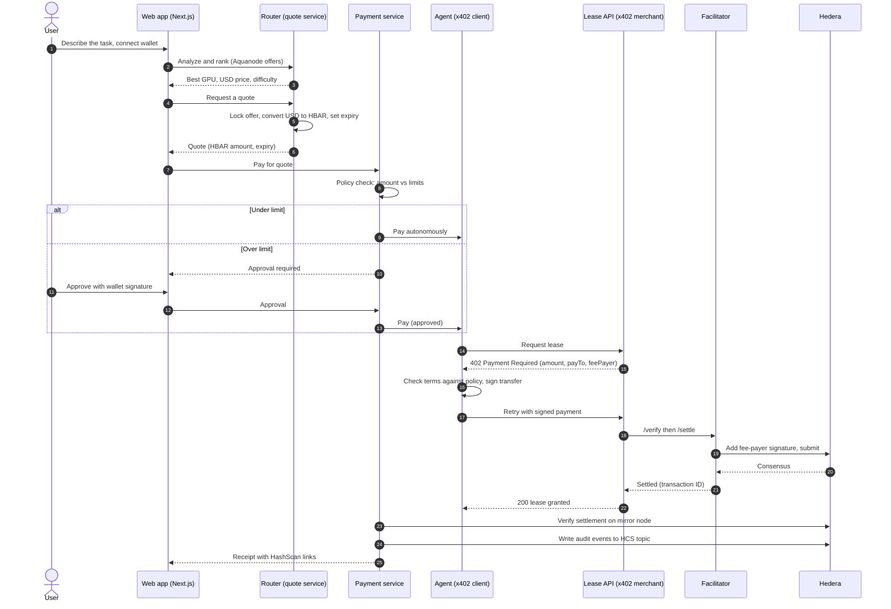
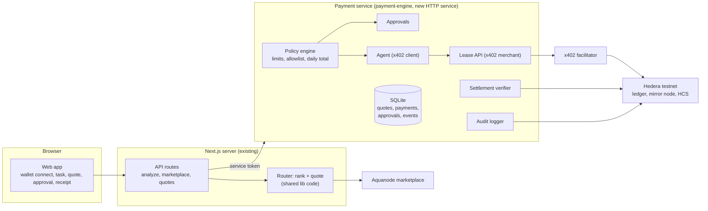
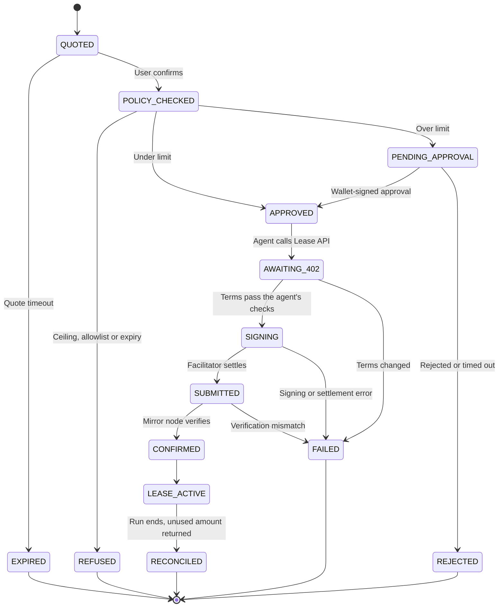

# GPU4U Final Design: From Wallet to Settled GPU Lease with an x402 Agent

This document analyzes the two halves of the project, the marketplace and router and the payment engine, designs the end-to-end product that joins them, and records what was built. Sections 1 to 12 are the design as it was reviewed. The implementation status below says what was built, where it differs from the design, and what has not been verified.

How to read it: start with the implementation status. Sections 1 to 4 explain what existed and what was missing. Sections 5 to 9 are the design. Section 10 is the build plan. Section 11 records how each decision was resolved.

## Implementation status

The whole flow is built and runs end to end: task input, best GPU and price, wallet, server-side quote in HBAR, spending policy, human approval, an x402 payment by an agent, independent verification, a lease, usage billing with a refund, and an audit trail. To run it, see the [root README](../README.md).

**Checks that passed.** The payment service has 100 tests and the web app has 103, none needing a network. A separate run started the real payment service and the real production web server and drove every flow through the web app's API with live marketplace data: automatic payment, approval, rejection, refusal above the hard ceiling, and rejection of a browser-supplied price. All 38 checks passed. The type check, lint and a production build are clean.

### Gaps from section 4.2, and how each was closed

| # | Gap | Resolution |
| --- | --- | --- |
| 1 | No real x402 flow | A real HTTP lease endpoint answers 402 with the exact price. The agent is an official x402 client. Verification and settlement use the official facilitator scheme, over HTTP, against a facilitator |
| 2 | USD and HBAR did not meet | The quote converts USD to HBAR at the Hedera network rate with integer math, always rounding up |
| 3 | Amounts not bound to a quote | The web app's server recomputes the ranking and price from live data. The browser sends no price, and extra fields are rejected |
| 4 | Terminal-only approval | Persistent approvals with an API, a screen, a countdown, and optional wallet-signature proof. Timeouts work |
| 5 | No wallet connection | WalletConnect for HashPack, plus a manual account ID fallback |
| 6 | State in memory | SQLite. Pending approvals survive a restart. A payment caught mid-flight is failed, never retried |
| 7 | Policy too thin | Per-payment, per-wallet daily, a hard ceiling that approval cannot override, a recipient allowlist, and a service-wide daily cap |
| 8 | Pre-flight failure ignored | The original engine now fails closed. The new flow uses the official facilitator checks, which also fail closed |
| 9 | Audit topic open to anyone | New topics are created with a submit key. The approval token is no longer logged. Events are hash-chained |
| 10 | README and code disagreed | Both rewritten. The limit is set in USD and documented |
| 11 | Loose settlement check | Verification requires the exact amount, the exact payer, no other recipient, and a trusted fee payer |

### Where the build differs from the design

- **Live status uses polling,** every 1.5 seconds, instead of a server-sent event stream. It is simpler and enough for a flow this short.
- **Click approval is the default** in the service, so the flow works without a wallet. `APPROVAL_MODE=wallet` requires a signature and is recommended for anything real.
- **A service-wide daily limit was added.** The design had per-wallet limits only. Nothing proves who is asking, and the agent spends the platform's funds, so inventing wallet IDs would have bypassed a per-wallet limit.
- **The amount paid is the cap,** which defaults to the estimate plus a quarter. The refund returns the unused part. The refund transfer costs the merchant a network fee, so the merchant keeps slightly less than the billed amount.
- **Simulated mode was added.** The repository has no Hedera credentials, so a mode that runs the real x402 loop over HTTP against a simulated ledger lets the whole flow run and be tested. Every receipt and the service banner say it is simulated.
- **Quotes expire after 10 minutes and approvals after 5,** and an approval always expires before its quote.

### Not verified

- **Real testnet settlement.** The testnet code paths use the official SDK and packages, but they need funded accounts to exercise. `npm run live:check` in the payment service proves them with one small payment and prints a HashScan link. It has not been run here.
- **Signing with a real HashPack wallet.** Signature verification is tested with keys generated by the SDK, in the format wallets return from `signMessage`. The wallet connection code is written against the library's published API and has not been used with a wallet.
- **The screens in a browser.** No browser was available. The screens were checked by the type system, lint, a production build, and by driving the same API calls they make.
- **A public facilitator.** Blocky402 and x402.org were confirmed to advertise Hedera testnet, but no payment was sent through either.

## 1. The product in one flow

A user describes a GPU task and connects a Hedera wallet. GPU4U finds the best GPU, prices it in USD, and converts that price to HBAR. A policy engine compares the amount with the user's spending limit. Under the limit, an AI agent pays on its own. Over the limit, a human must approve first. The payment uses the x402 protocol on Hedera, a facilitator settles it on-chain, GPU4U verifies the settlement independently, and every step is written to an audit log on the Hedera Consensus Service.



## 2. What the marketplace and router already do

Status: complete and verified against the live Aquanode feed. 74 unit tests pass.

| Capability | State |
| --- | --- |
| Live GPU offers from Aquanode, normalized, de-duplicated, cached | Done. About 500 offers from 10 providers |
| Natural-language analysis with strict schema validation | Done. Groq, seven validation layers |
| Difficulty chosen by the user or detected, and missing fields filled | Done |
| Duration and cost estimate per GPU, ranking by cost, balance or speed | Done. Estimates only, not benchmarks |
| Spending cap and simulated usage billing with reconciliation | Done, simulated |
| Server logging and a data-path panel | Done |

What it produces for payment: one selected offer with an hourly price in USD, an estimated duration, an estimated total in USD, and a user-approved spending cap in USD.

What it does not do: it prices in USD, it ranks in the browser, it has no wallet, and nothing it produces is bound to a payment.

## 3. What the payment engine already does

Location: `payment-engine/`. Eight modules, about 1,600 lines, plus a 14-scenario unit suite and a live testnet suite. It is plain Node (CommonJS) and runs from a terminal.

| Module | Job |
| --- | --- |
| `Payment_Service.js` | Runs one payment through an explicit state machine from received to confirmed |
| `Payment_Validator.js` | Checks account IDs, amount precision, currency, network and provider fields |
| `Spending_Limit.js` | One rule: up to 5 HBAR is automatic, above that needs a human |
| `Human_Approval.js` | Asks a person in the terminal, then issues a single-use token bound to the exact payment |
| `Wallet_Signer.js` | Builds and signs Hedera transfers, and resolves an EVM address to a native account |
| `x402_Payment_Engine.js` | Builds x402 payment requirements and payloads and settles them |
| `Settlement_Verifier.js` | Confirms the transaction on the Hedera mirror node |
| `Hcs_Audit_Logger.js` | Writes every lifecycle event to a Hedera Consensus Service topic |

Evidence it has run for real: the audit topic on testnet holds 37 messages, and the newest is a settled live x402 payment from the integration suite.

Strengths worth keeping: a strict state machine, approval tokens that are single-use, expiring and bound to the payment details, duplicate and tampered request detection, an audit logger that never fails a settled payment, and settlement verified independently on the mirror node.

## 4. Comparison and the gaps between the two halves

### 4.1 Side by side

| Aspect | Marketplace and router | Payment engine |
| --- | --- | --- |
| Language | TypeScript | JavaScript (CommonJS) |
| Runs as | Web app and API routes | Terminal program |
| Money unit | USD per hour | HBAR |
| Input comes from | A validated analysis and live offers | Whatever the caller passes in |
| Limit it enforces | A cap the user approves, in USD | 5 HBAR per payment |
| Human in the loop | None needed | A terminal prompt |
| State | Stateless, cached 30 seconds | In memory, lost on restart |
| Real or simulated | Real data, simulated billing | Real testnet payments |
| Audit | Server log lines | HCS topic |
| Validation | Zod schemas | Hand-written checks |
| Tests | 74, no network | 14 unit plus a live suite |

### 4.2 Gaps that block the end-to-end flow

Ranked by how much they matter.

1. **There is no x402 flow.** x402 is an HTTP loop: a server answers 402 with payment terms, a client pays and retries. The engine has no server and no HTTP client. Its "x402 mode" builds a payload and then settles it locally with the same account that created it. A public facilitator would very likely reject that payload, because Hedera's scheme requires the facilitator to be the transaction's fee payer and never a net sender of value, and the engine makes the sender the payer. This was reasoned from the spec and not tested against a facilitator.
2. **The money units do not meet.** The router prices in USD and the engine pays in HBAR. Nothing converts between them or locks a rate.
3. **Amounts are not bound to a quote.** The engine pays whatever amount the caller passes. In a web app the browser must never supply the amount. It has to come from a server-side quote that records the offer, the hours and the rate.
4. **Human approval only works in a terminal.** It reads from standard input. A web user cannot answer it. Its timeout setting is declared but never applied, so a pending approval waits forever.
5. **No wallet connection exists.** The README describes a `frontend/` folder with wallet code. That folder is not in the repository. Only the EVM-to-native account resolver exists.
6. **State is in memory.** Idempotency records, approval decisions and the rejected-request list vanish on restart. A restart mid-approval loses the request, and a replayed request could pay twice.
7. **The spending policy is too thin.** There is no daily or per-session total, so five 5-HBAR payments pass freely. There is no merchant allowlist and no hard ceiling that even a human cannot raise.
8. **Pre-flight failures are ignored.** If the balance check throws, the code logs a warning and continues. A payment safety check should fail closed. A test run showed it: the pre-flight call failed, the engine printed a warning, and the scenario still passed.
9. **The audit topic accepts anyone's messages.** The live topic has no submit key, so anyone can post a fake audit entry. Topic creation in the logger does not set one either. The approval token is also written into the on-chain log.
10. **Docs and code disagree.** The README says the limit is 10 HBAR. The code, the tests and the terminal menu say 5.
11. **Settlement checks are loose.** The verifier confirms the receiver was credited at least the expected amount. The x402 scheme requires an exact amount, and it should also check the payer and the memo.

### 4.3 The price of HBAR makes the limit matter

The Hedera mirror node publishes the network exchange rate. At the time of writing it was about 6.8 US cents per HBAR. At that rate:

| Example job | USD | HBAR | Against a 5 HBAR limit |
| --- | --- | --- | --- |
| Llama 3 8B, 5,000 prompts, cheapest GPU (RTX 3090) | about $0.34 | about 5.0 | Auto |
| Same job, fastest GPU (A100 80 GB) | about $0.93 | about 13.7 | Needs approval |

A fixed HBAR limit would drift as the price moves, and most real GPU jobs cost more than 5 HBAR. The limit should be set in USD and converted at quote time.

## 5. How x402 works on Hedera, and what the official packages give us

Source: the Hedera docs pages on how x402 works, the exact scheme, paying, merchant integration and facilitators.

**The roles.**

| Role | Job | In GPU4U |
| --- | --- | --- |
| Client | Asks for a paid resource, signs the payment | The GPU4U agent |
| Resource server | Replies 402 with the price, grants access after payment | The GPU4U Lease API |
| Facilitator | Verifies the payment, pays the network fee, submits to Hedera | A public testnet facilitator |

**The Hedera difference is the fee-payer model.** The client signs a transfer of value only. The facilitator becomes the transaction's payer, adds its signature, pays the fee and submits it. The merchant never runs a node or holds HBAR for fees, and the client does not need gas. The spec also requires the facilitator to check that the fee payer is never a net sender of value, that transfers balance to zero, that the amount credited to the merchant is exact, and that the transaction was not submitted before.

**What is verified to exist today (2026-11-06).**

- The official packages are published: `@x402/core`, `@x402/hedera`, `@x402/fetch`, `@x402/express` and `@x402/next`, all at version 2.30.0. The engine already depends on the first two.
- Two public facilitators answer on Hedera testnet with no account or key. Blocky402 at `api.testnet.blocky402.com` advertises fee payer `0.0.7162784`. The official one at `x402.org/facilitator` advertises `0.0.9185802`. Both were queried live.
- The server package supports a price computed per request, and a pay-to account computed per request. A quote-based price therefore fits without custom protocol work.
- The client package has built-in spend controls and a before-payment hook that can abort a payment. The hook is asynchronous, so it can wait for a human decision.
- The wallet signer is a small interface with an account ID and one function that returns a partially signed transfer. A HashPack signer can implement it.

**Two traps found in the packages.**

- By default the client only allows assets in its default table, capped at one US dollar per payment. On Hedera testnet that table contains USDC. Native HBAR is not in it, so paying in HBAR requires listing HBAR as an allowed asset with a cap. Otherwise every payment is blocked.
- The default dollar cap is a safety net. Our own policy engine must be the real limit, and the package cap should be set just above it.

**What this means for the existing engine.** Its hand-built x402 payload and local settlement should be replaced by the official client, server and a facilitator. The existing validator, approval tokens, mirror verification and HCS logger stay. They become the policy, approval, verification and audit parts around the official protocol code.

## 6. Target architecture



**Why the payment engine becomes its own service.** Earlier the advice was to keep the backend inside the Next.js app, because nothing needed secrets or durable state. That has changed. The payment side holds a private key, keeps approvals that must survive a restart, and runs a merchant endpoint and an agent that talk to each other over HTTP. It already lives in its own folder with its own dependencies. A separate Node service is now the right shape. The browser never talks to it directly. The Next.js server calls it with a service token, so no key or payment decision ever reaches the browser.

**Keys and trust.**

| Key | Held by | Used for |
| --- | --- | --- |
| Agent account key | Payment service only | Signs payments under the limit |
| Merchant account | Receives payments. Key needed only if refunds are sent | Receiving, and refunds |
| HCS submit key | Payment service only | Posting audit events, so no one else can |
| User wallet | User's HashPack | Identity, approvals, optional top-ups |

Nothing in the browser holds a spending key.

## 7. The x402 agent workflow, step by step

This is the workflow to explain end to end. Step numbers match the diagram in section 1.

### Step A: Task and wallet

1. The user opens GPU4U and sees what it does. They describe the task, optionally pick a difficulty, and connect a Hedera wallet.
2. The app resolves the wallet to a native Hedera account on the mirror node and confirms it is on testnet. An address with no account is rejected, as the engine already does.

### Step B: Best GPU and price

3. The existing router runs: validate the input, fill missing fields, fetch live Aquanode offers, estimate durations, and rank. The result is one selected GPU, with an hourly price and an estimated total in USD.

### Step C: Quote, the bridge between USD and HBAR

4. The user asks to rent the selected GPU. The server, not the browser, builds a **quote**. It re-fetches offers and confirms the selected offer is still available at no more than a small price drift from what the user saw.
5. It reads the network exchange rate from the mirror node and converts the USD total to HBAR, rounding up to a whole tinybar.
6. It stores the quote: offer, hours, USD price, HBAR amount, rate, wallet account, and an expiry of a few minutes. It returns the quote to the browser for display. The browser can read the quote but never sets its amount.

### Step D: Policy decision

7. The user confirms the quote and the Payment service starts a payment for that quote.
8. The policy engine compares the amount with the rules and records the decision.

| Rule | Behavior |
| --- | --- |
| Amount at or under the auto limit, and daily total still under its limit | Pay automatically |
| Amount over the auto limit, or the daily total would be exceeded | Hold for human approval |
| Amount over the hard ceiling | Refuse. No approval can override it |
| Pay-to account not on the allowlist | Refuse |
| Quote expired or already used | Refuse |

Limits are set in USD and compared in USD, so they do not drift with the HBAR price.

### Step E: Human approval, when needed

9. The payment moves to pending approval and is saved. The browser shows an approval card with the GPU, provider, hours, USD and HBAR amounts, the limit it exceeds, and a countdown.
10. The user approves or rejects. Approval is a **signature from the connected wallet** over the exact quote terms, so it is cryptographic consent and not a button click. The service verifies the signature against the wallet on the quote.
11. A rejection or a timeout ends the payment and is logged. An approval is bound to the quote, the pay-to account, the amount, the asset and the network, expires, and can be used once.

### Step F: The x402 payment

12. The agent calls the Lease API for the quote.
13. The Lease API answers **402 Payment Required** with the payment terms for this quote: scheme `exact`, network `hedera:testnet`, asset HBAR, the amount in tinybars, the merchant account, a timeout, and the facilitator's fee payer.
14. Before signing, the agent checks the terms against its own rules in a before-payment hook: same network, asset HBAR, pay-to on the allowlist, amount no more than the approved amount, and the fee payer is a known facilitator. It aborts on any mismatch. This stops a server from raising the price or changing the recipient after approval.
15. The agent signs a transfer from the agent account to the merchant, with the facilitator as the transaction payer, and retries the request with the signed payment attached.
16. The Lease API sends it to the facilitator to verify and settle. The facilitator checks the transaction, adds its fee-payer signature, submits it, and returns the transaction ID.
17. The Lease API replies 200 and creates the lease.

### Step G: Independent verification and audit

18. The Payment service does not trust the facilitator's answer. It reads the transaction from the mirror node and checks that it succeeded, that the merchant was credited exactly the quoted amount, that the payer is the agent account, and that the transaction ID is the one the facilitator returned for this quote. Only then does the payment become confirmed.
19. Every transition is saved and posted to the audit topic on the Hedera Consensus Service, each message linking to the one before it by hash so tampering is visible. The topic accepts messages only from our key.
20. The browser shows a receipt with the transaction ID and a HashScan link, the quote, the policy decision, who approved, and the audit trail.

### Step H: Lease and settlement of usage

21. Stage 0 simulates the lease. No GPU is rented from Aquanode, because that needs an Aquanode account and its private API. The lease record shows the selected offer and a simulated run under the existing usage-billing logic.
22. The user's approved cap is what was paid. When the simulated run ends, the actual cost is reconciled against what was paid. The unused amount is returned with an HBAR transfer from the merchant to the agent account, audited like everything else. Over-run is impossible because the run stops at the cap.

### Payment states



The existing engine's statuses map onto this. The new ones are quoted, expired, refused, awaiting 402, lease active and reconciled.

## 8. Design decisions, with a recommendation for each

| # | Question | Recommendation | Alternative and trade-off |
| --- | --- | --- | --- |
| D1 | Which asset pays? | Native HBAR. Easy to get from the faucet. The rate comes from the mirror node | Testnet USDC. Needs no conversion and earns an extra-points item, but the agent needs the token associated and test USDC in hand |
| D2 | Who pays? | A funded agent account signs payments under the limit. The connected wallet is used for identity and approvals | The user's wallet signs every payment through HashPack. More real, but a popup per payment breaks "autonomous". Keep as a stretch for over-limit payments |
| D3 | How is approval given? | A wallet signature over the exact quote terms | A button click. Simpler, but not cryptographic proof of consent |
| D4 | Which facilitator? | Blocky402 testnet, with the official x402.org one as a fallback. Both are verified live | Run our own. More control, but the spec's safety checks must all be implemented |
| D5 | Service shape? | A separate payment service, with the web app calling it server to server | Everything inside Next.js. One process, but secrets and durable approvals sit in the web app |
| D6 | What are the default limits? | Auto up to $0.50, daily total $5, hard ceiling $25. All configurable | A higher auto limit is smoother for a demo but weaker as a control |
| D7 | Unused amount | Pay the approved cap, refund the unused part on chain | Record only. Simpler, but the user's money is held without a return |
| D8 | Durable state | SQLite file | Postgres. More than the project needs |
| D9 | Metering style | One prepaid payment per lease. x402 is per-request and discrete, and Hedera's docs say it is not built for streaming | Repeated block payments during a long run. More realistic, much more complex |

With D6 at $0.50, the two example jobs in section 4.3 show both paths in a demo: the cheapest GPU pays itself, and the fastest GPU stops for approval.

## 9. Interfaces

### 9.1 New and changed routes

| Service | Route | Purpose |
| --- | --- | --- |
| Web app | `POST /api/quotes` | Build a server-side quote from the selected offer and a wallet account |
| Web app | `GET /api/quotes/:id` | Read a quote and its policy preview |
| Web app | `POST /api/payments` | Start a payment for a quote |
| Web app | `GET /api/payments/:id` | Status, timeline, receipt |
| Web app | `GET /api/payments/:id/events` | Live status stream |
| Web app | `POST /api/approvals/:id` | Submit the wallet-signed decision |
| Payment service | `POST /v1/payments`, `GET /v1/payments/:id` | The same, behind a service token |
| Payment service | `POST /v1/leases` | The x402-protected Lease API. 402 first, 200 after payment |
| Payment service | `GET /v1/audit` | Audit events for a payment |

The web app routes are thin and forward to the Payment service, as the marketplace routes do today.

### 9.2 Quote

```json
{
  "quoteId": "q_8f2a...",
  "offerId": "simplepod:483:1",
  "gpu": "RTX 3090",
  "provider": "simplepod",
  "hours": 1.54,
  "usd": { "hourly": 0.22, "total": 0.34 },
  "rate": { "usdPerHbar": 0.068125, "source": "hedera-mirror-node", "validUntil": "2026-11-06T10:00:00Z" },
  "hbar": { "amount": "4.97", "tinybars": "497000000" },
  "payTo": "0.0.11326195",
  "wallet": "0.0.11329382",
  "expiresAt": "2026-11-06T09:36:00Z",
  "policyPreview": { "decision": "auto", "autoLimitUsd": 0.5 }
}
```

### 9.3 Audit event

```json
{
  "version": "2.0",
  "paymentId": "pay_...",
  "quoteId": "q_...",
  "seq": 7,
  "prevHash": "sha256:...",
  "eventType": "SETTLEMENT_VERIFIED",
  "status": "CONFIRMED",
  "transactionId": "0.0.7162784@1793912526.894421774",
  "timestamp": "2026-11-06T09:34:12.000Z",
  "details": { "amountTinybars": "497000000", "payer": "0.0.11329400", "payTo": "0.0.11326195" }
}
```

Events never contain keys or approval tokens.

### 9.4 Stored data

| Table | Holds |
| --- | --- |
| quotes | The quote, its expiry and whether it was used |
| payments | State, amounts, transaction ID, settlement record |
| approvals | Request, decision, wallet signature, expiry, whether consumed |
| spend_ledger | Confirmed spend per wallet, for the daily total |
| audit_events | Every event, its hash link and its HCS sequence number |
| leases | The lease, the simulated run and the reconciliation |

## 10. Build plan

Each phase ends with something demonstrable and a test that proves it.

| Phase | Work | Done when |
| --- | --- | --- |
| 0. Stabilize the engine | Fix the README limit, make the unit tests hermetic and fast, make pre-flight fail closed, set a submit key on a new audit topic, add the SQLite store | All 14 scenarios pass with no env and no network. A restart does not lose a pending approval |
| 1. Quote service | Server-side ranking, exchange rate from the mirror node, quote storage and expiry, price-drift check | A quote's HBAR amount equals USD divided by the live rate, expires on time, and cannot be created from a browser-supplied amount |
| 2. x402 payment loop | Lease API as an x402 merchant, agent as an x402 client with the before-payment hook and spend controls, Blocky402 as facilitator, independent mirror verification | One real testnet payment settles through the facilitator and shows on HashScan. A tampered price or recipient is aborted |
| 3. Policy and approvals | USD limits, daily total, hard ceiling, allowlist, pending approvals in the database, wallet-signed approval, timeout | Under-limit pays itself. Over-limit waits, and rejects or expires correctly. A replayed approval fails |
| 4. Web flow | Landing explanation, wallet connect, quote screen, approval card, live status timeline, receipt with HashScan links | A new user completes the whole flow in the browser |
| 5. Lease and reconciliation | Simulated lease, run under the cap, reconcile, refund the unused part | Paid, used and refunded amounts add up exactly, and the refund appears on HashScan |
| 6. Hardening and submission | Rate limits, error states, README with a settled transaction ID, 5-minute demo video | Fresh clone to working demo from the README alone |
| Stretch | Wallet-signed payment for over-limit amounts, agent identity (HCS-14), USDC settlement, multi-agent negotiation | Only if time remains |

If time is short, the minimum that still shows the full story is phases 1, 2, 3 and 4 with a button-click approval, which drops phase 5 and the wallet signature.

### Mapping to the Hedera hackathon requirements

| Requirement or bonus | Covered by |
| --- | --- |
| An x402-protected endpoint settling on Hedera through a listed facilitator | Lease API with Blocky402. Phase 2 |
| An agent that completes a paid request with no human approving | The agent under the auto limit. Phases 2 and 3 |
| Public repo with README, setup, architecture, payment flow, a settled transaction ID | Phase 6 |
| Demo video, 5 minutes or less, with a HashScan link | Phase 6 |
| Spending controls: budgets, limits, allowlists, human approval above an amount | Phase 3 |
| Audit log on an HCS topic | Phase 0 and every phase after |
| Wallet identity, agent identity | Phase 4, and the stretch item |
| Hedera Agent Kit or Network MCP | Not planned |

## 11. Decisions, and how they were resolved

The recommendations in section 8 were used as the defaults.

| # | Decision | Taken |
| --- | --- | --- |
| D1 | Payment asset | Native HBAR, converted from USD at the network rate |
| D2 | Who pays | A funded agent account. The connected wallet gives identity and approvals |
| D3 | How approval is given | Both. A wallet signature (`APPROVAL_MODE=wallet`) or a click (`click`, the default) |
| D4 | Facilitator | Hosted Blocky402 testnet by default. The official x402.org facilitator or a local one by setting |
| D5 | Service shape | A separate payment service. The web app calls it server to server |
| D6 | Default limits | $0.50 automatic, $5 daily per wallet, $25 hard ceiling, $50 service-wide. All configurable |
| D7 | Unused amount | The cap is paid, and the unused part is refunded on the ledger |
| D8 | Durable state | SQLite through Node's built-in module, so there is no native build step |
| D9 | Metering | One prepaid payment per lease |

## 12. Honest limits of the first version

- The lease is simulated. Renting a real GPU needs an Aquanode account and its private API.
- Nothing proves who is asking, so the agent's exposure is bounded by the service-wide daily limit. A production version should fund the agent from the user's own wallet and require a signed session.
- Performance and duration remain model-based estimates. The amount paid is the approved cap, so the user is protected from a bad estimate, and the unused part is returned.
- Everything runs on Hedera testnet. HBAR there has no value, and the exchange rate used is the real network rate.
- Public testnet facilitators can be slow or unavailable. The fallback facilitator and an optional self-run one reduce this risk.
- Wallet connection through HashPack needs a short spike first, because it has not been tried in this project.

## Appendix: payment engine review notes

| File | Observation |
| --- | --- |
| `Payment_Service.js` | Clear state machine. Idempotency is an in-memory map. The x402 branch signs and settles locally with one operator key, so payer, fee payer and facilitator are the same account |
| `Payment_Validator.js` | Good checks. A second in-memory map also tracks requests. It records a request as processed before payment, so a failed payment looks like a duplicate on retry unless the service ignores the flag, which it does |
| `Spending_Limit.js` | Single per-payment limit in HBAR. No total, no allowlist, no ceiling |
| `Human_Approval.js` | Terminal prompt only. The timeout parameter is never used. The token is bound to the payment details. Decisions live in memory |
| `Wallet_Signer.js` | Account resolution is useful and should be kept. Transfers use floating HBAR values, so tinybars should be used directly. A fixed consensus node is hard-coded |
| `x402_Payment_Engine.js` | Hand-built payloads. Pre-flight failure is swallowed and the code continues. Imports a helper it never uses. To be replaced by the official client, server and facilitator |
| `Settlement_Verifier.js` | Retries while the mirror node ingests. Checks the receiver credit is at least the expected amount, not exact, and does not check the payer or memo |
| `Hcs_Audit_Logger.js` | Never fails a settled payment, which is right. Creates a topic with no submit key. Logs the approval token. One network call per event, with retries, adds latency to every payment |
| Tests | 14 scenarios. 11 pass with no environment file and 14 pass with an account ID set. The x402 scenario takes 6 to 27 seconds across runs because it makes a pre-flight network call, and it passes even when that call fails. The README's "zero network dependencies" is therefore not accurate |
