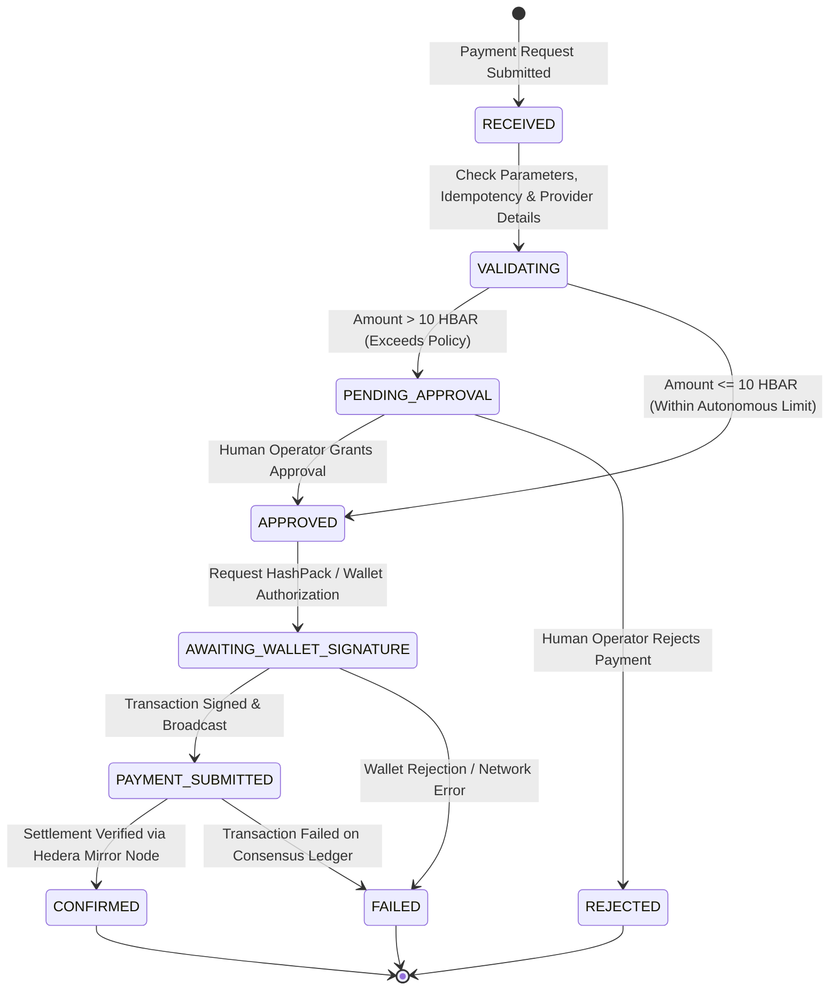

# GPU Router Payment & Human Approval Engine (x402 on Hedera)

Core payment engine built for the **AI Agents That Pay: x402 on Hedera** track. This engine autonomously handles GPU resource payments (such as NVIDIA H100 rentals), enforces autonomous spending limits (10 HBAR), requests single-use human approvals for high-value transactions, integrates the official x402 v2 protocol on Hedera Testnet, logs immutable audit events to Hedera Consensus Service (HCS), and independently verifies on-chain settlement via Hedera Mirror Nodes.

---

## 1. Project Architecture

```text
x-402 payment/
│
├── payment/
│   ├── Payment_Service.js       # Core Payment Orchestrator (Idempotent state machine)
│   ├── Payment_Validator.js     # Request validation, amount precision & duplicate prevention
│   ├── Spending_Limit.js        # Spending policy evaluation (<= 10 HBAR auto-approved)
│   ├── Human_Approval.js        # Terminal-based approval with single-use replay-proof tokens
│   ├── Wallet_Signer.js         # HIP-820 tx builder, EVM-to-Native account resolver & signer
│   ├── Settlement_Verifier.js   # Mirror node settlement validator (transfer balances & status)
│   ├── Hcs_Audit_Logger.js      # Hedera Consensus Service (HCS) immutable audit logger
│   └── x402_Payment_Engine.js   # Official x402 v2 payment scheme (exact transfer & facilitator)
│
├── tests/
│   ├── unit_payment_engine.test.js # Automated 14-scenario unit test suite
│   └── testnet_integration.js      # Live Hedera Testnet integration test suite
│
├── frontend/                    # React + Vite wallet connection & signing bridge
│   ├── src/
│   │   ├── config/wallet.js    # Hedera WalletConnect & AppKit configuration
│   │   └── App.jsx             # Native account verifier & HashPack transaction bridge
│
├── index.js                     # Interactive terminal payment CLI
├── package.json                 # npm scripts & dependencies (@hiero-ledger/sdk, @x402/hedera)
├── .env                         # Hedera Testnet operator credentials & topic ID
└── .gitignore                   # Secrets and artifact protection
```

---

## 2. Payment Lifecycle & Status State Machine

Every payment transitions through strict explicit statuses:



---

## 3. Key Components & Implementation Details

### A. Native HashPack Wallet Integration & Account Resolution
* **EVM-to-Native Hedera Resolution**: Solves the discrepancy where AppKit/Wagmi reports EVM addresses (`0x667f405f60Dc55Ca7707b18df6c6c0B9915c382B`). Queries the mirror node to verify that it maps to native Hedera account `0.0.11329382`, identifies the key type (`ECDSA_SECP256K1`), retrieves balance, and prevents unregistered EVM-only addresses from being accepted.
* **Network Verification**: Ensures the connected chain matches `hedera:testnet` (CAIP-2).
* **HIP-820 Serialization**: Serializes native `TransferTransaction` into Base64-encoded protobuf bytes for HashPack signing via `universalProvider`.

### B. Spending Limit & Human Approval Engine
* **Spending Policy**: Default 10 HBAR limit per transaction.
* **Replay-Proof Approval Tokens**: When human approval is granted, a cryptographically random, parameter-bound approval token is issued (`appr_<sha256>`). The orchestrator validates that parameters were not modified, checks a 5-minute expiry, and consumes the token upon use to prevent replay attacks.
* **Rejection Lockout**: Rejection immediately terminates execution and prevents re-execution of the rejected request ID.

### C. Official x402 v2 Protocol on Hedera
* Uses official `@x402/hedera` and `@x402/core` packages.
* Implements the `exact` payment scheme targeting `hedera:testnet`:
  - `PaymentRequirements`: Asset `0.0.0` (native HBAR), amount in tinybars ($1 \text{ HBAR} = 10^8 \text{ tinybars}$), `payTo`, and facilitator `feePayer`.
  - `PaymentPayload`: `x402Version: 2`, accepted terms, resource lease URL, and Base64-encoded transaction bytes.
  - Preflight verification via mirror node (`createHederaPreflightTransfer`).
  - Facilitator settlement flow supporting external HTTP facilitators or local operator facilitator.

### D. Hedera Consensus Service (HCS) Audit Trail
* Logs every lifecycle transition to HCS Topic: `0.0.11329896`.
* Sanitizes payloads to ensure private keys and sensitive data are never recorded on-chain.
* **Resiliency**: HCS network errors trigger retries and fallback to in-memory audit logs without falsely marking an already settled blockchain transfer as `FAILED`.

### E. Independent Settlement Verification
* Verifies settlement directly via Hedera Mirror Node (`https://testnet.mirrornode.hedera.com/api/v1/transactions/<txId>`).
* Confirms `result === "SUCCESS"`, checks debit/credit amounts match expected tinybars, and records consensus timestamps.

---

## 4. Test Scenarios & Execution

### Run Automated Unit Test Suite (Mocked & Isolated)
Runs 14 unit test scenarios with zero network dependencies:
```bash
npm test
```
**Covered Scenarios:**
1. Payment of 5 HBAR (within limit) -> Auto-approved
2. Payment of exactly 10 HBAR (boundary) -> Auto-approved
3. Payment of 15 HBAR (exceeds limit) -> Requires human approval
4. Human approves payment -> Issues token and advances
5. Human rejects payment -> Status `REJECTED`, no blockchain call
6. Wallet signature rejected -> Fails gracefully
7. Invalid receiver account ID -> Validation error
8. Negative or zero amount -> Validation error
9. Unsupported currency (e.g. ETH) -> Validation error
10. Wrong network (e.g. mainnet) -> Blocked
11. Duplicate request ID -> Strict idempotency (no duplicate transfer)
12. Duplicate request with altered details -> Tampering detection
13. x402 Payment Requirements & Payload -> Official v2 spec validation
14. HCS network failure -> In-memory fallback without payment corruption

### Run Real Testnet Integration Tests (Live on Hedera Testnet)
Executes real transactions on Hedera Testnet, writes to HCS topic, and verifies settlement on mirror node:
```bash
npm run test:live
```

---

## 5. Stable Interface for Future Backend & Frontend

The engine exports clean functions ready to be wrapped in REST endpoints or frontend hooks:

```javascript
const { processPayment, PaymentStatus } = require("./payment/Payment_Service");

// Example: Calling the engine from a backend router or agent
const result = await processPayment({
    requestId: "req_gpu_lease_101",
    receiverAccountId: "0.0.11326195",
    amount: 1.5,
    currency: "HBAR",
    network: "testnet",
    protocol: "x402", // or "native"
    provider: {
        providerId: "lambdalabs-node-1",
        gpuModel: "NVIDIA H100 80GB",
        durationHours: 1,
        ratePerHour: 1.5
    }
});

console.log(result.status);         // "CONFIRMED"
console.log(result.transactionId);  // "0.0.11326170@1793912526.894421774"
console.log(result.settlement);     // Settlement details & HashScan link
```

